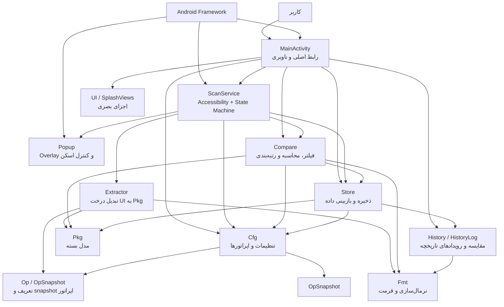
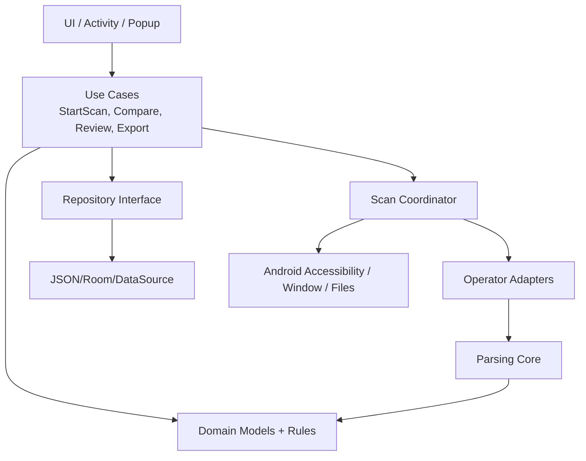
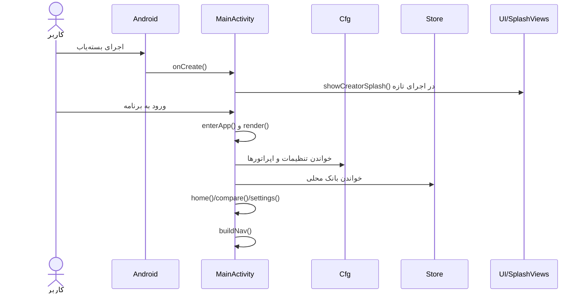
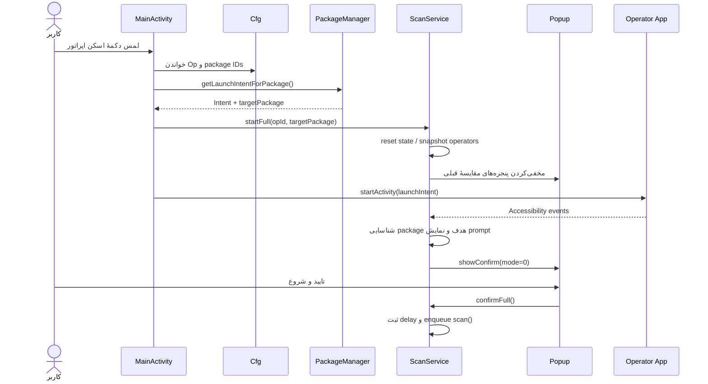
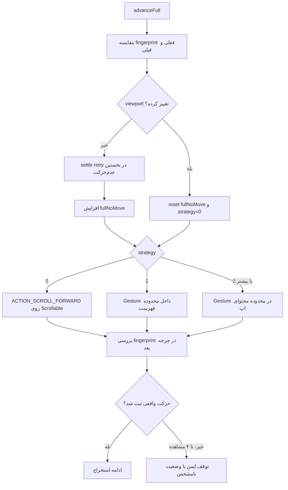
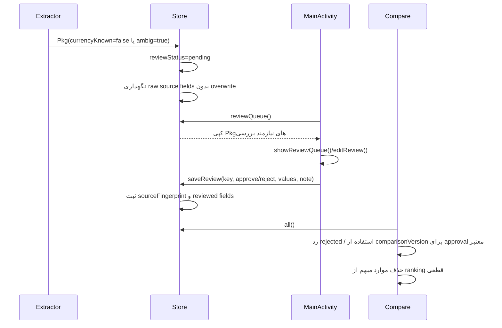

<div dir="rtl">

# نقشهٔ مرجع معماری و گراف وابستگی‌های بسته‌یاب

> **شناسهٔ سند:** `BASTEHYAB-AI-ARCH-GRAPH`  
> **نسخهٔ مبنا:** سورس `1.6.8`، بستهٔ اصلاح‌شدهٔ اسکرول ایرانسل  
> **تاریخ تهیه:** ۸ نوامبر ۲۰۲۶  
> **زبان:** فارسی  
> **مخاطب اصلی:** AIهای برنامه‌نویس، توسعه‌دهندگان، ممیزان کد و نگه‌دارندگان پروژه  
> **هدف:** تبدیل این سند به نقشهٔ حافظهٔ فنی پروژه؛ به‌گونه‌ای که AI پیش از هر تغییر بداند برنامه چه می‌کند، هر قابلیت در کدام فایل است، وابستگی‌ها کدام‌اند، منطق داده و کنترل چیست، برای هر عیب از کجا باید شروع کند و پس از تغییر چه چیزی را باید آزمایش کند.

---

## ۰. دستور استفاده از این سند برای AI

این سند را قبل از هر کار روی پروژه بخوان. این سند «نقشهٔ راهنما» است، نه جایگزین سورس. **سورس فعلی همیشه مرجع نهایی رفتار برنامه است.** اگر سورس نسبت به نسخهٔ مبنای این سند تغییر کرده، ابتدا اختلاف را پیدا کن و این سند را نیز به‌روزرسانی کن.

### ۰.۱ قوانین غیرقابل‌مذاکره

1. **قبل از ویرایش، مسیر اجرا را دنبال کن.** از رویداد یا دکمه‌ای که کاربر لمس می‌کند شروع کن و تا آخرین تابعی که داده را ذخیره، نمایش یا تغییر می‌دهد ادامه بده.
2. **فقط با دیدن نام یک کلاس نتیجه‌گیری نکن.** تمام call siteها، متغیرهای state، مسیرهای خطا و lifecycle مرتبط را جست‌وجو کن.
3. **هر ادعای باگ باید شاهد داشته باشد.** شاهد می‌تواند کد، تست شکست‌خورده، لاگ ناشناس، replay یا رفتار بازتولیدشده روی دستگاه باشد. فرضیه را با برچسب «نیازمند بررسی» بنویس.
4. **هر تغییر رفتاری باید تست رگرسیون داشته باشد.** ابتدا تستی بنویس که رفتار درست را مشخص کند، سپس کد را اصلاح کن.
5. **تغییر یک لایه را به لایه‌های نامرتبط سرایت نده.** برای مثال، باگ اسکرول را با تغییر Parser یا رتبه‌بندی درمان نکن، مگر اینکه زنجیرهٔ شواهد چنین نیازی را ثابت کند.
6. **دادهٔ خام استخراج‌شده را با دادهٔ تأییدشدهٔ دستی یکی نکن.** فیلدهای `reviewed*` لایهٔ مجزای تأیید هستند. خروجی خام Parser را بی‌صدا بازنویسی نکن.
7. **مقدار مبهم را قطعی اعلام نکن.** قیمت یا واحد پول ناشناخته نباید وارد رتبه‌بندی قطعی شود.
8. **پذیرفته‌شدن فرمان اسکرول را معادل حرکت صفحه ندان.** `performAction()` یا `dispatchGesture()` فقط پذیرش درخواست را نشان می‌دهد؛ تغییر viewport باید در چرخهٔ بعدی با شواهد مستقل بررسی شود.
9. **صفحهٔ ثابت را پایان فهرست ندان.** فقط `ListEndDetector.State.END_CONFIRMED` می‌تواند مبنای اعلام پایان قطعی باشد؛ اگر مسیر تشخیص به سرویس وصل نیست، باید آن نقص را گزارش و اصلاح کنی، نه اینکه پیام موفقیت بسازی.
10. **رفتار خرید/پرداخت/فعال‌سازی اضافه نکن.** دامنهٔ فعلی برنامه خواندن صفحه و مقایسه است؛ اقدام مالی یا عملیاتی روی حساب کاربر خارج از هدف برنامه است.
11. **حریم خصوصی را حفظ کن.** متن صفحه، شماره، OTP، رمز، دادهٔ قابل‌ویرایش یا اطلاعات شخصی را وارد log، fixture، تست یا گزارش نکن.
12. **تست محلی را با تست واقعی اشتباه نگیر.** نتیجه را دقیق بنویس: smoke test، JUnit، compile، lint، emulator یا دستگاه واقعی.
13. **نسخه و دادهٔ قبلی را نشکن.** `applicationId`، امضای انتشار، ساختار `data.json` و کلیدهای SharedPreferences را بدون migration طراحی‌شده تغییر نده.
14. **از بازنویسی بزرگ و یک‌باره پرهیز کن.** Refactor باید مرحله‌ای، با تست‌های پوششی و خروجی قابل مقایسه انجام شود.
15. **در پایان کار، سند، گزارش تغییرات، تست و محدودیت‌های تأییدنشده را به‌روزرسانی کن.**

### ۰.۲ روند اجباری هر وظیفه

```text
درخواست کاربر
   ↓
تعیین قابلیت/نشانهٔ خرابی
   ↓
پیدا کردن نقطهٔ ورود از جدول «عیب‌یابی سریع»
   ↓
خواندن کد نقطهٔ ورود + تمام فراخوان‌ها/مصرف‌کننده‌ها
   ↓
رسم زنجیرهٔ وابستگی واقعی و تعیین state/data contract
   ↓
تشخیص: باگ قطعی / منطق ناقص / ریسک / پیشنهاد توسعه
   ↓
ساخت fixture یا تست بازتولیدکننده
   ↓
کمترین تغییر ممکن با حفظ قراردادهای قبلی
   ↓
اجرای تست‌های مربوط + تست‌های رگرسیون سراسری
   ↓
بازبینی diff و بررسی اثر جانبی
   ↓
ثبت نتیجه، فایل‌ها، تست‌ها، محدودیت‌ها و TODO در همین سند
```

### ۰.۳ قالب گزارش نهایی AI پس از هر اصلاح

```text
عنوان مشکل:
رفتار قبل:
رفتار مورد انتظار:
علت ریشه‌ای و شاهد:
مسیر اجرای درگیر:
فایل‌ها و توابع تغییرکرده:
تغییر انجام‌شده:
تست جدید:
تست‌های اجراشده و خروجی:
تست‌هایی که اجرا نشدند و دلیل:
آزمون واقعی دستگاه:
ریسک/محدودیت باقیمانده:
مستندات به‌روزشده:
```

---

# ۱. هویت، هدف و مرزهای محصول

## ۱.۱ بسته‌یاب چیست؟

بسته‌یاب یک برنامهٔ Android بومی با Java است که کاربر را قادر می‌کند بسته‌های اینترنت قابل مشاهده در اپلیکیشن اپراتورهای تلفن همراه را استخراج کند، اطلاعات آن‌ها را روی گوشی نگهداری کند، بسته‌های معتبر را بر اساس معیار انتخابی رتبه‌بندی کند و نتیجه را در رابط اصلی یا پنجرهٔ شناور نشان دهد.

برنامه خودش اپلیکیشن اپراتور را جایگزین نمی‌کند. کاربر اپراتور را باز می‌کند، خودش به صفحهٔ بسته‌های اینترنت می‌رود و شروع استخراج را در پنجرهٔ شناور تأیید می‌کند. بسته‌یاب با Accessibility tree محتوای قابل‌مشاهده را می‌خواند و در حالت استخراج کامل، فهرست را مرحله‌به‌مرحله پیمایش می‌کند.

## ۱.۲ کارهایی که برنامه انجام می‌دهد

- نمایش صفحهٔ خانه، وضعیت دسترسی، آمار و اپراتورها.
- بازکردن اپلیکیشن اپراتور با `PackageManager.getLaunchIntentForPackage()`.
- خواندن ساختار قابل‌دسترسی UI اپراتور با سرویس `AccessibilityService`.
- تشخیص صفحهٔ بسته‌ها و شناسایی کارت/عنوان/حجم/مدت/قیمت.
- تبدیل مبلغ‌ها به واحد داخلی تومان و علامت‌گذاری ابهام‌ها.
- ذخیرهٔ محلی داده‌ها و سابقهٔ تغییر قیمت/حجم/مدت.
- مقایسهٔ بسته‌ها با فیلتر و معیار انتخاب‌شده.
- نمایش پنجرهٔ شناور مقایسه و پنجرهٔ کنترل/گزارش استخراج.
- صف بازبینی انسانی برای داده‌های مشکوک.
- خروجی CSV بسته‌ها و TXT گزارش تشخیصی.
- مدیریت اپراتورهای داخلی و افزودن اپراتور سفارشی.

## ۱.۳ کارهایی که برنامه نباید انجام دهد

- ورود خودکار به حساب اپراتور.
- خواندن یا ثبت رمز، OTP یا فیلد قابل‌ویرایش کاربر.
- کلیک خودکار روی «خرید»، «پرداخت»، «فعال‌سازی»، «تمدید» یا هر عملیات تغییردهندهٔ حساب.
- ارسال محتوای صفحه یا بانک بسته‌ها به سرور خارجی.
- حدس‌زدن قیمت یا واحد پول ناشناخته و نشان‌دادن آن به‌عنوان قیمت قطعی.
- اعلام پایان فهرست فقط به دلیل بی‌حرکتی viewport.

## ۱.۴ معماری فعلی در یک نگاه

- **پلتفرم:** Android native / Java.
- **Application ID / namespace:** `app.bastehyab`.
- **نسخهٔ سورس مبنا:** `1.6.8`.
- **minSdk:** 24.
- **targetSdk:** 34.
- **compileSdk:** 34.
- **Java:** 17.
- **Android Gradle Plugin:** 8.5.2.
- **Gradle مورد استفاده در CI:** 8.7.
- **معماری UI:** View-based؛ صفحات داخل `MainActivity` به‌صورت برنامه‌نویسی‌شده ساخته می‌شوند.
- **معماری اسکن:** `AccessibilityService` + Handler روی main thread + تک‌پردازشگر `ExecutorService` برای کار سنگین.
- **داده:** JSON محلی (`data.json`) و SharedPreferences (`cfg`).
- **شبکهٔ اختصاصی بسته‌یاب:** در Manifest فعلی مجوز INTERNET وجود ندارد؛ خود اپراتور برای بارگیری صفحه ممکن است از اینترنت خودش استفاده کند.

---

# ۲. گراف کلان معماری

## ۲.۱ گراف وابستگی ماژول‌ها

این گراف وابستگی منطقی کد را نشان می‌دهد؛ پیکان یعنی ماژول بالادست از ماژول پایین‌دست استفاده می‌کند یا دادهٔ آن را مصرف می‌کند.



## ۲.۲ مرزبندی مسئولیت‌ها

| لایه | مسئولیت | مالک اصلی |
|---|---|---|
| Presentation | صفحات خانه/مقایسه/تنظیمات، ناوبری، بازبینی، خروجی | `MainActivity` |
| Accessibility orchestration | دریافت رویدادها، تشخیص اپراتور/صفحه، شروع و توقف، زمان‌بندی، worker | `ScanService` |
| Floating presentation | پنجرهٔ مقایسه، پنجرهٔ کنترل اسکن، progress، drag، touch flags | `Popup` |
| Extraction | درخت‌سازی Accessibility، تشخیص کارت، استخراج حجم/مدت/قیمت/واحد/نوع | `Extractor` |
| Domain model | اپراتور، snapshot اپراتور، بسته و محاسبات per-GiB/monthly | `Op`, `OpSnapshot`, `Pkg` |
| Comparison | فیلترها، metric، VAT، رتبه، هشدار ارزان غیرعادی | `Compare` |
| Persistence | فایل `data.json`، merge، backup، review queue | `Store` |
| Configuration | SharedPreferences، اپراتورها، گزینه‌ها، currency display | `Cfg` |
| History | کشف تفاوت دو مشاهده و نگهداری eventهای تاریخچه | `History`, `HistoryLog` |
| Utilities | فارسی‌سازی عدد، normalization، parse عدد، VAT | `Fmt` |
| Visual primitives | رنگ‌ها، کارت‌ها، دکمه‌ها و viewهای Splash | `UI`, `SplashViews` |

## ۲.۳ قانون وابستگی برای توسعهٔ آینده

معماری فعلی در چند کلاس، مسئولیت‌های متعددی را جمع کرده است. هنگام refactor، وابستگی پیشنهادی آینده چنین باشد:



**توجه:** این گراف، پیشنهاد معماری است و به معنی وجود این کلاس‌ها در سورس فعلی نیست. فعلاً `ScanService` هم Coordinator و هم adapter/scroll orchestration و diagnostics را بر عهده دارد؛ `Extractor` نیز عمومی است و adapter مجزا برای هر اپراتور وجود ندارد.

---

# ۳. گراف جریان اجرای برنامه (Runtime Flows)

## ۳.۱ جریان اجرای برنامه از شروع تا صفحهٔ اصلی



### نقاط ورود فایل

- `MainActivity.onCreate()` — راه‌اندازی shell و Splash.
- `MainActivity.showCreatorSplash()` — صفحهٔ آغازین.
- `MainActivity.enterApp()` — خروج از Splash و render.
- `MainActivity.render()` — ساخت دوبارهٔ صفحهٔ فعلی و بازیابی scroll position.
- `MainActivity.buildNav()` — ناوبری سه‌تب.
- `MainActivity.onSaveInstanceState()` — ذخیرهٔ تب و موقعیت scroll.

## ۳.۲ جریان انتخاب اپراتور و شروع استخراج کامل



**کد فعلی:**

- `MainActivity.home()` دکمهٔ اپراتور را می‌سازد.
- `MainActivity.launch(Op)` (حدود خطوط 473–506) اپراتور را با package id باز می‌کند.
- `ScanService.startFull()` state نشست را reset و snapshot اپراتورها را ثبت می‌کند.
- `ScanService.promptRunnable` پنجرهٔ تایید را می‌سازد/بازیابی می‌کند.
- `Popup.showConfirm()` کنترل شناور را render می‌کند.
- callback دکمهٔ «تایید و شروع» به `ScanService.confirmFull()` می‌رسد.

## ۳.۳ جریان اسکن خودکار پس از تایید

```mermaid
flowchart TD
    A[confirmFull()] --> B[تنظیم fullNextScanAt]
    B --> C[Handler.postDelayed(job)]
    C --> D[scan() روی سرویس]
    D --> E{fullMode و تایید و pause؟}
    E -->|Pause/Not confirmed| F[عدم اجرای worker یا انتظار]
    E -->|مجاز| G[تک‌پردازشگر scanExecutor]
    G --> H[performScanWork()]
    H --> I[getWindows / active root]
    I --> J[فیلتر package هدف]
    J --> K[Extractor.extract()]
    K --> L[Store.upsert()]
    L --> M[Compare.run() فقط برای مقایسهٔ غیر Full]
    H --> N[ScanOutcome]
    N --> O[Handler.post finishScan()]
    O --> P[ادغام fullSignatures در fullSeen]
    P --> Q{صفحه تشخیص داده شد؟}
    Q -->|خیر| R[افزایش probe / fallback پس از حد مجاز]
    Q -->|بله| S[beginFullScanning()]
    S --> T[advanceFull()]
    T --> U[fingerprint و شمارندهٔ حرکت]
    U --> V[performAdaptiveScroll() روی worker]
    V --> W[finishFullScroll()]
    W --> X[انتظار settle و scan چرخه بعد]
```

### قاعدهٔ threadها

- رویدادهای Accessibility به `ScanService.onAccessibilityEvent()` می‌رسند.
- `Handler h` متعلق به `Looper.getMainLooper()` برای state/UI و زمان‌بندی استفاده می‌شود.
- کار سنگین در `scanExecutor` تک‌نخی انجام می‌شود.
- `performScanWork()` باید بدون WindowManager/Popup UI باقی بماند.
- `finishScan()` نتایج worker را در main/service thread اعمال می‌کند.
- `performAdaptiveScroll()` روی worker اجرا می‌شود، اما dispatch gesture از main handler فراخوانی می‌شود.
- اگر thread ownership تغییر کرد، تست race و lifecycle لازم است.

## ۳.۴ جریان تطبیقی اسکرول



### سه سطح اسکرول فعلی

1. **Accessibility action:** `AccessibilityNodeInfo.ACTION_SCROLL_FORWARD` روی node انتخاب‌شده.
2. **Swipe در فهرست:** gesture عمودی روی bounds اسکرول‌ویوی پیدا شده.
3. **Swipe در محتوای برنامه:** fallback روی bounds کلی اپراتور، وقتی فهرست داخلی swipe را نمی‌گیرد.

نکتهٔ بحرانی: `performAction()` اگر `true` برگرداند، فقط یعنی درخواست پذیرفته شده است. خود کد نیز به همین دلیل fingerprint را در چرخهٔ بعد بررسی می‌کند.

## ۳.۵ جریان استخراج داده تا رتبه‌بندی

```mermaid
flowchart LR
    A[AccessibilityNodeInfo tree] --> B[Extractor.build]
    B --> C[درخت داخلی N]
    C --> D[تشخیص leafها]
    D --> E[تشخیص volume / duration / price / unit]
    E --> F[findCards + make]
    F --> G[flatPairs هندسی]
    G --> H[fromText fallback]
    H --> I[Pkg + key + ambiguity]
    I --> J[Store.upsert]
    J --> K[Store.all]
    K --> L[manual review overlay]
    L --> M[Compare.run]
    M --> N[فیلتر و normalization]
    N --> O[رتبه‌بندی]
    O --> P[MainActivity / Popup]
```



## ۳.۶ جریان دادهٔ مبهم و بازبینی انسانی



## ۳.۷ گراف پنجره‌های شناور

در `Popup` دو پنجرهٔ مستقل در WindowManager وجود دارد:

- `root`: پنجرهٔ مقایسه (`show()`/`hide()`).
- `confirmRoot`: پنجرهٔ کنترل اسکن و گزارش (`showConfirm()`/`hideConfirm()`).

این دو overlay عمداً هم‌زمان نمایش داده نمی‌شوند؛ overlay مقایسه ممکن است swipe کاربر را بپوشاند. در زمان gesture نیز کنترل اسکن موقتاً با `FLAG_NOT_TOUCHABLE` از لمس خارج می‌شود و سپس restore می‌شود.

---

# ۴. نقشهٔ فایل‌ها و مسئولیت دقیق هر فایل

## ۴.۱ فایل‌های Java اصلی

| فایل | مسئولیت فعلی | ورودی | خروجی/مصرف‌کننده | نقطهٔ شروع بررسی |
|---|---|---|---|---|
| `MainActivity.java` | lifecycle، Splash، سه تب، تنظیمات، انتخاب اپراتور، صف بازبینی، CSV/TXT | touch، Android lifecycle، Cfg/Store | Viewها، launch، تنظیمات و خروجی | `onCreate`, `render`, `home`, `launch` |
| `ScanService.java` | Accessibility، state machine اسکن، worker، زمان‌بندی، تشخیص صفحه، scroll، fingerprint، diagnostics | Accessibility events و تایید کاربر | `Extractor`, `Store`, `Compare`, `Popup` | `onAccessibilityEvent`, `startFull`, `confirmFull`, `scan` |
| `Popup.java` | ساخت/حذف overlay، دکمه‌های شروع/مکث/خروج، مقایسه، drag، progress، touch block | Result و فرمان‌های ScanService | WindowManager | `show`, `showConfirm`, `hideConfirm` |
| `Extractor.java` | ساخت مدل از Accessibility tree و parse حجم/مدت/قیمت/واحد/دسته | `AccessibilityNodeInfo`, `Op` | `Extractor.Result`, `Pkg` | `extract`, `extractOnce`, `make`, `pick` |
| `Compare.java` | فیلتر، حذف موارد مبهم، انتخاب metric و مرتب‌سازی | `Store.all`, `Cfg`, keys همین صفحه | `Compare.Result` برای Activity/Popup | `run`, `value`, `sortRanked` |
| `Store.java` | load/save JSON، backup، upsert، freshness timestamp، manual review | `Pkg`ها و Context | داده برای Compare و UI | `load`, `upsert`, `saveReview` |
| `Cfg.java` | SharedPreferences، default operators، migration، metric/filter/currency settings | Context و user settings | `Op`, `OpSnapshot`, مقادیر تنظیمات | `ops`, `metric`, `snapshotOps` |
| `Pkg.java` | مدل دادهٔ بسته، محاسبات، signature، source fingerprint، review overlay | fields استخراج/ذخیره‌شده | Store/Compare/UI | `sig`, `sourceFingerprint`, `comparisonVersion` |
| `Op.java` | مدل تنظیمات اپراتور و package IDها | JSON/کاربر | Cfg/Extractor | `json`, `from` |
| `OpSnapshot.java` | نسخهٔ immutable از تنظیمات اپراتورها برای ثبات نشست | Op | ScanService | constructor, `toOp`, `ownsPackage` |
| `ListEndDetector.java` | تشخیص سه‌حالتهٔ پایان فهرست متصل به حلقهٔ اسکن | scrollY/maxY، itemCount/toIndex، load-more، fingerprint و scanCycle | state: MORE/END/UNKNOWN | `observe`, `observeStableViewport`, `reset` |
| `History.java` | diff دو مشاهدهٔ بسته | دو Pkg | HistoryLog | `diff` |
| `HistoryLog.java` | نگهداری تاریخچهٔ تغییرات و error-codeها در Preferences | old/new Pkg یا review event | MainActivity | `record`, `recordReview`, `recent` |
| `Fmt.java` | normalize متن، parse finite number، فارسی‌سازی و VAT | متن/عدد | تقریباً همهٔ لایه‌ها | `norm`, `parse`, `withVat` |
| `UI.java` | رنگ، dp، ساخت viewهای پایه، card/button/text | Context و style args | MainActivity/Popup/SplashViews | `tv`, `btn`, `card`, `lp` |
| `SplashViews.java` | viewهای سفارشی Splash و عناصر برند | Canvas/Context | MainActivity Splash | `Backdrop.onDraw`, `PackageWifiLogo.onDraw` |

## ۴.۲ فایل‌های Android و Build

| مسیر | کاربرد | نکتهٔ مهم |
|---|---|---|
| `app/src/main/AndroidManifest.xml` | ثبت Activity، Accessibility Service، package visibility queries، سیاست Backup/Cleartext | `allowBackup=false` و `usesCleartextTraffic=false`؛ INTERNET در manifest فعلی نیست |
| `app/src/main/res/xml/service_config.xml` | نوع eventهای Accessibility، retrieve window content و gesture | eventها: window state، window content، view scrolled؛ `canPerformGestures=true` |
| `app/src/main/res/values/strings.xml` | label برنامه و توضیح مجوز Accessibility | متن توضیح باید دقیق و منطبق با رفتار واقعی بماند |
| `app/build.gradle` | application id، SDKها، نسخه، Java 17، signing و JUnit | نسخهٔ `1.6.8`؛ minSdk24/target34/compile34 |
| `build.gradle` | نسخهٔ AGP | AGP 8.5.2 |
| `settings.gradle` | نام پروژه و ماژول‌ها | `:app` |
| `gradle.properties` | تنظیمات Gradle | هر تغییر باید با CI سنجیده شود |
| `.github/workflows/android-build.yml` | CI، تست، lint، build و release | release فقط روی `main` و بعد از build-test |
| `.github/dependabot.yml` | بررسی به‌روزرسانی dependencyها | تغییر dependency باید با smoke و Gradle تست شود |
| `keystore.properties.example` | نمونهٔ کلید امضا | هرگز رمز/keystore واقعی را commit نکن |
| `branding/` | لوگو، آیکن، تصویر سازنده | تغییر دارایی باید خروجی mipmap و مجوز استفاده را بررسی کند |

## ۴.۳ ابزارهای تست و توسعه

| مسیر | چه چیزی را بررسی می‌کند؟ |
|---|---|
| `tools/fixture-sanitizer/sanitize_accessibility.py` | ماسک‌کردن شناسه/شماره/ایمیل و حذف فیلدهای editable/password از fixture |
| `tools/fixture-sanitizer/test.sh` | تست سیاست ناشناس‌سازی |
| `tools/parser-smoke-tests/ParserSmokeTest.java` | normalization، currency، extraction، ambiguity، privacy و flat-pair |
| `tools/parser-smoke-tests/run.sh` | اجرای Parser smoke با test doubles |
| `tools/android-core-smoke-tests/ScanServiceSmokeTest.java` | قرارداد state/scan، انتخاب scrollable و رفتارهای ScanService |
| `tools/android-core-smoke-tests/ReviewQueueSmokeTest.java` | provenance بازبینی، snapshot و history |
| `tools/android-core-smoke-tests/ListEndDetectorTest.java` | آزمون مستقل detector پایان فهرست |
| `tools/android-core-smoke-tests/run.sh` | اجرای core smoke و compile با test doubles |
| `tools/android-core-smoke-tests/check-accessibility-api.sh` | جلوگیری از استفاده از APIهای Accessibility خارج از compileSdk 34 |
| `tools/popup-overlay-smoke-tests/PopupOverlayTest.java` | پنجرهٔ واحد، drag، position memory، final report، remove، stale listener |
| `tools/popup-overlay-smoke-tests/run.sh` | اجرای Popup smoke با FakeWindowManager و stubs |
| `tools/ui-layout-smoke-tests/run.sh` | بررسی RTL/layout و قرارداد Popup/ScanService |
| `tools/dump-replay/` | بازپخش tree dump در harness محدود برای بازتولید parser |
| `app/src/test/java/app/bastehyab/` | JUnit tests واقعی ماژول برای ListEndDetector و OpSnapshot |

## ۴.۴ مستندات موجود در repository

| سند | نقش |
|---|---|
| `README.md` | معرفی و راه‌اندازی |
| `AUDIT_AND_ROADMAP_1_6_8_FA.md` | ممیزی نسخهٔ 1.6.8 و یافته‌های اسکرول |
| `PROMPTS_NEXT_STEPS_FA.md` | پرامپت‌های توسعهٔ مرحله‌ای |
| `IRANCELL_AUTOSCROLL_FIX_1_6_7_FA.md` | سابقهٔ مسیرهای اسکرول ایرانسل |
| `POPUP_RECOVERY_FIX_1_6_8_FA.md` | بازیابی پنجرهٔ شناور |
| `ARCHITECTURE_PLAN_FA.md` | جهت معماری آینده، adapterها و شواهد |
| `INSTALL_AND_BUILD_FA.md` | راهنمای ساخت و تست |
| `CHANGELOG.md` | تاریخچهٔ تغییرات نسخه‌ها |
| `AUDIT_IMPLEMENTATION_STATUS_1_6_5_FA.md` | وضعیت اقدامات ممیزی قبلی |
| `DESIGN_SYSTEM_FA.md`, `UI_ALIGNMENT_AUDIT_FA.md` | طراحی و هم‌ترازی رابط |
| `SECURITY_PLAY_PROTECT_FA.md`, `BAZAAR_SIGNING_FA.md` | امنیت، امضا و انتشار |

---

# ۵. مدل‌های داده و قراردادهای اصلی

## ۵.۱ مدل Operator — `Op`

هر اپراتور شامل این اطلاعات است:

| فیلد | معنی |
|---|---|
| `id` | شناسهٔ پایدار داخلی، مانند `irancell` |
| `name` | نام نمایشی |
| `cur` | واحد ورودی: `IRR`، `IRT` یا `AUTO` |
| `pkgs` | package IDهای برنامهٔ رسمی اپراتور |
| `color` | رنگ برند در UI |
| `enabled` | اجازهٔ استخراج خودکار از این اپراتور |
| `cmp` | مشارکت در مقایسه |
| `builtin` | اپراتور داخلی یا سفارشی |
| `policy` | سیاست قدیمی/فعلی انتخاب مبلغ رقابتی داخل کارت: 0 auto، 1 بزرگ‌تر، 2 کوچک‌تر |

### اپراتورهای پیش‌فرض فعلی

| ID داخلی | نام | package ID | واحد اولیه |
|---|---|---|---|
| `irancell` | ایرانسل | `com.myirancell` | `IRR` |
| `mci` | همراه اول | `ir.mci.ecareapp` | `AUTO` |
| `rightel` | رایتل | `ir.rightel.myrightel` | `AUTO` |
| `samantel` | سامانتل | `com.mysamantel` | `IRR` |
| `shatel` | شاتل | `com.shmapp` | `AUTO` |

Package IDهای بالا در `Cfg.defaults()` هستند. آن‌ها تضمین نمی‌کنند تمام نسخه‌های فعلی اپراتورها از نظر UI سازگار باشند؛ سازگاری واقعی باید تست شود.

### قرارداد تغییر Op

- package ID معتبر باید با `Cfg.validPackageName()` اعتبارسنجی شود.
- یک package ID نباید به بیش از یک operator اختصاص یابد.
- تنظیمات فعال/مشارکت در مقایسه را با هم اشتباه نگیر: `enabled` برای scan است و `cmp` برای ranking.
- هنگام شروع Full Scan، `OpSnapshot` ساخته می‌شود تا تغییر تنظیمات وسط نشست، هویت اپراتور آن نشست را تغییر ندهد.

## ۵.۲ مدل Pkg — بستهٔ اینترنت

فیلدهای مهم `Pkg`:

| فیلد | معنی/قانون |
|---|---|
| `op` | operator id مالک بسته |
| `key` | کلید استخراجی/پایدار برای upsert و review |
| `title` | متن عنوان قابل‌نمایش |
| `code` | کد شناخته‌شدهٔ بسته، اگر از tree قابل استخراج باشد |
| `why` | علت محدودبودن یا دستهٔ ویژه؛ برای بین‌الملل prefix مشخص دارد |
| `gb` | حجم به گیگابایت داخلی |
| `days` | اعتبار به روز؛ ساعت به fraction روز تبدیل می‌شود؛ صفر یعنی نامشخص |
| `toman` | مبلغ پایهٔ داخلی به تومان، نه واحد نمایشی |
| `ts` | زمان مشاهدهٔ آخر |
| `restricted` | آیا بسته محدود/ویژه تشخیص داده شده است |
| `ambig` | آیا انتخاب مبلغ/فیلدها مبهم است |
| `currencyKnown` | آیا واحد پول قابل اثبات است |
| `note` | علت/یادداشت پردازش |
| `raw` | ورودی موقت Parser؛ `Store.upsert()` پیش از نگهداری آن را خالی می‌کند |
| `alts` | مبالغ جایگزین تشخیص‌داده‌شده در کارت |
| `reviewStatus` | `none`, `pending`, `approved`, `rejected` |
| `reviewNote` | یادداشت انسانی |
| `reviewSourceFingerprint` | اثبات اینکه تایید مربوط به همان دادهٔ منبع فعلی بوده |
| `reviewedGb`, `reviewedDays`, `reviewedToman` | مقادیر دستی تأییدشده؛ جدا از raw fields |
| `reviewedAt` | زمان تصمیم انسانی |

### امضای هویت بسته

`Pkg.sig()` از `op + حجم + مدت + قیمت + دسته/why` استفاده می‌کند. تفاوت نوع بسته مانند شبانه یا بین‌الملل باید مانع ادغام دو بستهٔ غیرقابل‌جایگزین شود.

### sourceFingerprint و اعتبار تایید دستی

- `sourceFingerprint()` بر اساس کلید، عنوان، کد، حجم، مدت، قیمت، currencyKnown، ambiguity، why و alts ساخته می‌شود.
- `hasCurrentManualApproval()` فقط وقتی true می‌شود که وضعیت approved باشد، مقادیر در محدوده باشند و fingerprint فعلی با fingerprint زمان تایید برابر بماند.
- `comparisonVersion()` در صورت تایید معتبر یک کپی با مقادیر دستی می‌سازد؛ شیء خام تغییر نمی‌کند.
- تغییر دادهٔ استخراجی باید تایید قبلی را stale کند.

## ۵.۳ واحد پول و قیمت

**قانون پایه:** همهٔ مبالغ قابل‌مقایسه داخل مدل `Pkg.toman` به تومان هستند.

- `IRR` یعنی ورودی ریال و باید بر ۱۰ تقسیم شود تا تومان داخلی به دست آید.
- `IRT` یعنی ورودی تومان.
- `AUTO` یعنی Parser باید از متن/نشانهٔ واحد پول استفاده کند؛ در نبود شواهد معتبر، currencyKnown=false و ambiguity حفظ می‌شود.
- `Cfg.displayCurrency()` فقط نحوهٔ نمایش را انتخاب می‌کند؛ مقدار ذخیره‌شده را تغییر نمی‌دهد.
- `Cfg.priceLabel()` در صورت انتخاب ریال، مقدار تومانی را ×۱۰ می‌کند.
- `Cfg.finalPrice()` با `Fmt.withVat()` مالیات/ارزش افزوده را اعمال می‌کند.
- قیمت پایه در `Pkg.toman` ذخیره می‌شود؛ VAT باید فقط در مرحلهٔ مقایسه/نمایش نهایی اعمال شود، نه دوبار.

**قاعدهٔ اصلاح:** اگر باگ قیمت گزارش شد، همهٔ این نقاط را با هم بررسی کن: `Extractor.price()/toman()/pick()` → `Pkg.toman/currencyKnown` → `Store.upsert()` → `Cfg.vat/finalPrice/priceLabel` → `Compare.value()` → UI.

## ۵.۴ تنظیمات `Cfg` و کلیدهای SharedPreferences

SharedPreferences file: `cfg`.

| کلید/Getter | مقدار پیش‌فرض یا محدوده | اثر |
|---|---|---|
| `ops` | JSON اپراتورها | package mapping و قابلیت‌ها |
| `defv` | migration version 5 | تکمیل/اصلاح default operatorها |
| `metric` | `PER_GB` | معیار رتبه‌بندی |
| `metricModeVersion` | migration | تغییر معنی index معیارهای قدیمی |
| `minGb` | 0، clamp 0..5000 | حداقل حجم |
| `maxDays` | 0، clamp 0..36500 | حداکثر مدت |
| `restricted` | true | نمایش بسته‌های ویژه/محدود |
| `intl` | false | نمایش بین‌الملل/رومینگ |
| `usage` | 30 GB، clamp 0.1..5000 | مصرف ماهانهٔ کاربر |
| `popup` | true | نمایش خودکار popup مقایسه |
| `rows` | 3، clamp 3..8 | تعداد ردیف‌های popup |
| `hide` | 0 یا 8/15/30 | مدت auto-hide popup |
| `bottom` | false | جای پنجرهٔ شناور |
| `fresh` | 3 روز؛ 7/14/30 نیز پذیرفته می‌شود | تازگی داده برای ranking |
| `minOps` | حداقل 1 | حداقل اپراتور مقایسه‌شده برای popup خودکار |
| `pmode` | 0؛ 0=هر دو، 1=کل، 2=همین صفحه | محتوای popup |
| `bucket` | 0..4 | فیلتر مدت اعتبار |
| `vat` | 10%، clamp 0..100 | مالیات در مقایسه/نمایش نهایی |
| `displayCurrency` | IRT | واحد نمایشی تومان/ریال |

### نکتهٔ مهم: mismatch معیار `PER_GB_MONTH`

در `Cfg.java` ثابت `PER_GB_MONTH = 3` تعریف شده و `Compare.value()` و label آن را پشتیبانی می‌کنند؛ اما UI فعلی فقط سه گزینهٔ `PER_GB`, `DURATION`, `MY_USAGE` را نمایش می‌دهد و `Cfg.metric()` مقدار را تا `MY_USAGE` (عدد ۲) clamp می‌کند. در نتیجه مقدار ۳ از این مسیر قابل انتخاب/بازیابی نیست. این مورد در سورس مبنا **ناسازگاری قطعی میان مدل/موتور/UI** است، نه صرفاً پیشنهاد.

هر اصلاح آن باید migration `metricModeVersion` و backward compatibility indexهای قدیمی را در نظر بگیرد.

## ۵.۵ دادهٔ ذخیره‌شده

- بانک بسته‌ها: `filesDir/data.json`.
- فایل موقت نوشتن: `data.json.tmp`.
- backup: `data.json.bak`.
- بارگذاری به حافظه: `Store.m`، یک `LinkedHashMap<String, Pkg>`.
- ذخیره با الگوی temp → backup → replace انجام می‌شود.
- ذخیرهٔ تغییرات upsert به‌صورت batch و با فاصلهٔ حداقل ۴ ثانیه انجام می‌شود؛ `flush()` برای توقف/خروج/پایان نشست داده‌های dirty را زودتر می‌نویسد.
- `HistoryLog` در SharedPreferences key `history` می‌نویسد و تاریخچه را به ۳۰۰ رویداد محدود می‌کند.
- raw page text در مسیر نهایی Store نگهداری نمی‌شود؛ `p.raw` قبل از `m.put()` پاک می‌شود.

**ریسک طراحی آینده:** ساختار JSON فایل اصلی نسخه/Schema واضح مستقل ندارد. هر تغییر schema باید با defaultهای امن، migration و تست دادهٔ واقعی قبلی همراه باشد.

---

# ۶. منطق دقیق استخراج (Extractor)

## ۶.۱ ورودی و خروجی

ورودی: `AccessibilityNodeInfo root`, `Op op`, ارتفاع صفحه.  
خروجی: `Extractor.Result` شامل `items`, `keys`, `nodes`, `leaves`, `maxDepth`, `duplicates`, `incomplete`, `incompleteReason`, `dump` و آمار traversal.

## ۶.۲ pipeline داخلی

1. `extract()` ابتدا یک traversal سریع با `pruneHidden=true` انجام می‌دهد.
2. اگر هیچ leaf قابل‌خواندن نباشد اما شاخهٔ مخفی prune شده باشد، یک بار traversal کامل‌تر انجام می‌شود.
3. `build()` درخت داخلی `N` را می‌سازد و برای جلوگیری از گیرکردن، عمق و تعداد node سقف دارد: عمق ۴۸ و حداکثر ۴۵۰۰ node.
4. `build()` nodeهای editable و password را حذف می‌کند؛ تنها متن/description گره‌های visible خوانده می‌شود.
5. `mark()` و `count()` فهرست leafها و شمارنده‌های قیمت/حجم را روی درخت محاسبه می‌کنند.
6. هر leaf برای price/unit/volume بررسی می‌شود.
7. `findCards()` کارت‌های محتمل را پیدا می‌کند.
8. `make()` هر card را می‌سازد؛ اگر یک container بیش از یک volume title داشته باشد رد می‌شود تا قیمت کارت‌های مختلف قاطی نشوند.
9. `flatPairs()` همیشه اجرا می‌شود تا فهرست‌هایی که Accessibility tree آن‌ها به شکل یک شاخهٔ aggregate درآمده با proximity و geometry جفت‌سازی شوند.
10. `fromText()` fallback برای nodeهایی است که متن کامل package را در خود دارند.
11. duplicate keyها ادغام می‌شوند.
12. اگر tree ناقص باشد، همهٔ نتیجه‌های همان traversal `ambig=true` می‌شوند.
13. اگر هیچ بسته‌ای از درخت خوانا بیرون نیاید، Result به‌عنوان extraction ناقص/ناموفق علامت می‌خورد؛ empty success فرض نمی‌شود.

## ۶.۳ استخراج حجم و مدت

Patternها در ابتدای `Extractor.java` تعریف شده‌اند:

- حجم: GB/MB/TB و معادل‌های فارسی.
- مدت: ساعت، روز، هفته، ماه، سال و عبارات نوشتاری مانند «یک‌ماهه».
- عنوان ممکن است هم حجم و هم مدت داشته باشد.
- `dur()` مدت را به روز تبدیل می‌کند؛ مدت‌های خیلی بزرگ در `mk()` برای جلوگیری از مقدار نامعقول به صفر تبدیل می‌شوند.
- `vol()` حجم را به GB داخلی تبدیل می‌کند.

**نکتهٔ توسعه:** Pattern جدید نباید بدون fixture فارسی/انگلیسی، عدد فارسی/لاتین، ارقام اعشاری، فاصلهٔ نیم‌فاصله و separatorهای قیمت وارد شود.

## ۶.۴ تشخیص قیمت و واحد پول

- `price()`/`PRICE` انواع عدد با comma/point و پسوند تومان/تومن/ریال/هزار/میلیون را می‌خواند.
- `UNITONLY` امکان جداشدن عدد و واحد را در دو leaf مختلف پوشش می‌دهد.
- `TPRICE` قیمت داخل عنوان مانند `...تومان` را با قواعد محدود می‌خواند.
- `kind()`/`labelKind()` برچسب‌های مجاور را به انواع قیمت دسته‌بندی می‌کند: base، main/final، unit/monthly، old، discount/credit، other.
- `pick()` شواهد کاندیدها را جمع و بر اساس label/geometry/unit ترجیح می‌دهد.
- اگر واحد پول نامعلوم یا چند قیمت متناقض باشد، `ambig` و یادداشت ثبت می‌شود.
- `titlePrice()` می‌تواند قیمت داخل عنوان را با `alts` مقایسه کند؛ اگر قیمت title در alternatives نباشد، ambiguity فعال می‌شود.

**اصل قطعی:** مبلغ‌های مجاور یک کارت را صرفاً با بزرگ‌ترین/کوچک‌ترین بودن انتخاب نکن؛ ابتدا label و ارتباط فضایی آن‌ها را بررسی کن.

## ۶.۵ دسته‌بندی بسته‌های خاص

`whyOf()` و Patternهای آن انواع محدودیت را شناسایی می‌کنند؛ از جمله شبانه، نذر آب، روزهای خاص، مشترک جدید/ثبت‌نام، ملی/داخلی، پیامک/مکالمه، سرویس/اشتراک، تمدید/رزرو، نامحدود، اپلیکیشن‌ها، محدودیت ویژه و رومینگ/بین‌الملل.

- بین‌الملل با `INTL_WHY` جداست.
- `restricted` به `why` وابسته است.
- `Compare.passesSpecialFilters()` سوئیچ بین‌الملل را از سوئیچ بسته‌های ویژه جدا می‌کند.
- دسته‌بندی باید بر اساس متن خود کارت باشد؛ عنوان تب صفحه نباید اشتباهاً تمام کارت‌ها را restricted کند.

## ۶.۶ محدودیت معماری استخراج فعلی

- `Extractor` عمومی است؛ adapter اختصاصی و نسخه‌دار مجزا برای ایرانسل/همراه اول/رایتل/سامانتل/شاتل در سورس فعلی وجود ندارد.
- الگوها و label rankingها عمدتاً heuristic و مبتنی بر متن و geometry هستند.
- تغییر layout اپراتور می‌تواند باعث missing package، wrong price pairing یا ambiguity بیش از حد شود.
- تعداد node/عمق محدود است؛ درخت خیلی بزرگ می‌تواند incomplete شود.
- نتیجهٔ ناقص به‌درستی ambiguous می‌شود، اما diagnostics و UI آینده باید علت ناقص بودن را به کاربر/توسعه‌دهنده شفاف‌تر کنند.

---

# ۷. منطق اسکن و کنترل state در ScanService

## ۷.۱ Stateهای اصلی

`ScanService` یک state machine نسبتاً بزرگ با فیلدهای static دارد. فیلدهای مهم:

| State/Counter | معنی |
|---|---|
| `fullMode` | آیا نشست full extraction فعال است |
| `fullConfirmed` | آیا کاربر شروع را در popup تایید کرده |
| `fullPaused` | مکث دستی؛ داده/viewport حفظ می‌شود |
| `fullStartedScanning` | آیا وارد مرحلهٔ استخراج و پیمایش شده‌ایم |
| `fullTargetPackage` | package هدف نشست |
| `fullTargetOpId` | operator id هدف |
| `fullTargetObservedOnce` | آیا package هدف واقعاً foreground/event شده |
| `fullSteps` | تعداد چرخه‌های پیمایش |
| `fullNoNew` | تعداد چرخه‌های بدون بستهٔ جدید؛ فعلاً محاسبه می‌شود ولی در شرط توقف مصرف نمی‌شود |
| `fullNoMove` | تعداد مشاهده‌های fingerprint بدون تغییر |
| `fullScrollStrategy` | سطح escalation اسکرول |
| `fullSeen` | set امضای بسته‌های یکتا در کل نشست |
| `fullLastFingerprint` | fingerprint مرحلهٔ قبلی |
| `fullNextScanAt` | قفل زمانی اجرای scan بعدی |
| `fullObservedScrollPercent` | درصد تقریبی scroll از eventهای Android؛ پایان فهرست را ثابت نمی‌کند |
| `fullEndState` | سه‌حالته: UNKNOWN/MORE_AVAILABLE/END_CONFIRMED |
| `fullFinished` | فقط وقتی true می‌شود که fullEndState قطعی باشد |
| `lastScrollMethod` | روش آخر تلاش اسکرول |
| `lastGestureResult` | dispatch/callback gesture |
| `promptDismissed` | کاربر «بعداً» زده است |
| `scanning`, `scanAgain` | کنترل جلوگیری از اجرای هم‌زمان worker |

## ۷.۲ مرحله‌های نشست

| Phase | شرط | رفتار |
|---|---|---|
| `IDLE` | `fullMode=false` و `fullFinished=false` | نشست فعال نیست |
| `WAITING_CONFIRM` | `fullMode=true`, `fullConfirmed=false` | منتظر تایید صریح کاربر |
| `WAITING_PAGE` | تایید شده، اما هنوز شروع استخراج تشخیص داده نشده | صفحهٔ بسته‌ها را تشخیص بده/پس از ۳ probe fallback محدود |
| `SCANNING` | `fullStartedScanning=true` و pause نیست | استخراج، fingerprint و اسکرول مرحله‌ای |
| `PAUSED` | `fullPaused=true` | نگهداری seen set و viewport، توقف job و timeout |
| `FINISHED` | fullMode خاموش و fullFinished=true | فقط پایان قطعی با evidence |
| Stopped/Unknown | fullMode خاموش و fullFinished=false | توقف به دلایل ایمن/خطا/عدم حرکت، نه پایان قطعی |

تابع نمایشی `phase()` همهٔ جزئیات state را خلاصه می‌کند؛ در تغییرات state، همهٔ پرچم‌ها باید با هم سازگار باشند.

## ۷.۳ زمان‌بندی و سقف‌ها

مقادیر فعلی در `ScanService`:

- `FULL_CONFIRM_DELAY_MS = 1800`.
- `FULL_PROMPT_DELAY_MS = 900`.
- `FULL_PROMPT_RETRY_MS = 900`.
- `FULL_PROMPT_MAX_ATTEMPTS = 240`.
- `FULL_SCROLL_SETTLE_MS = 1100`.
- `FULL_SETTLE_RETRY_MS = 750`.
- `FULL_RESUME_DELAY_MS = 350`.
- `FULL_PAGE_PROBE_LIMIT = 3`.
- `FULL_MAX_STEPS = 120`.
- `FULL_WAIT_MS = 240000`.
- `FULL_MAX_MS = 300000`.

هر تغییر این مقادیر باید روی دستگاه کند، صفحه‌های lazy loading، شبکهٔ کند، modal و app transition تست شود.

## ۷.۴ زمان‌بندی Accessibility event

`onAccessibilityEvent()`:

1. package name رویداد را می‌خواند.
2. برای target، `fullTargetObservedOnce` را تنظیم می‌کند.
3. از `TYPE_VIEW_SCROLLED` درصد تقریبی scroll را با event `scrollY/maxScrollY` محاسبه می‌کند.
4. در تغییر window، اگر از target خارج شده‌ایم و pause نیست، full scan را متوقف می‌کند.
5. پنجرهٔ overlay را در زمان‌های لازم پنهان/بازیابی می‌کند.
6. package event را به `Op` مربوط وصل می‌کند.
7. `eventScanDelay()` زمان مجاز بعدی را تعیین می‌کند.
8. job قبلی را debounce و job جدید را schedule می‌کند.

**نکته:** `eventScanDelay()` نباید قفل `fullNextScanAt` را با scroll eventهای پرتکرار دور بزند.

## ۷.۵ Worker scan

`scan()` فقط شروع کار را مدیریت می‌کند. `performScanWork()`:

- `getWindows()` را می‌خواند و فقط `TYPE_APPLICATION` را می‌گیرد.
- در نبود root از `getRootInActiveWindow()` fallback می‌کند.
- در full scan، فقط package هدف را می‌پذیرد.
- با `operatorForScan()` از snapshot نشست استفاده می‌کند.
- `Extractor.extract()` را صدا می‌زند.
- `Store.upsert()` را انجام می‌دهد.
- خروجی `ScanOutcome` را برمی‌گرداند.
- در پایان `finishScan()` روی Handler اعمال می‌شود.

## ۷.۶ منطق توقف

توقف می‌تواند ناشی از:

- پایان زمان انتظار برای صفحه/تایید.
- سقف ۱۲۰ step یا ۵ دقیقه اسکن.
- چهار مشاهدهٔ عدم حرکت.
- خروج کاربر از اپراتور.
- خاموش‌شدن/قطع‌شدن Accessibility Service.
- نبود worker یا gesture failure.
- cancel کاربر.

**قانون گزارش:** بسیاری از این موارد stop هستند، نه completion. `fullFinished` باید فقط از `END_CONFIRMED` حاصل شود.

---

# ۷.۹ زمان‌بندی اسکن و جلوگیری از Event Starvation

`onAccessibilityEvent()` باید رویدادهای پرتعداد را **تجمیع** کند. لغو و زمان‌بندی مجدد job برای هر event خطر starvation دارد؛ به‌ویژه در MyIrancell که نمونه‌های ثبت‌شده فاصله‌های چند میلی‌ثانیه‌ای دارند. در سورس 1.6.8 از `jobScheduled` و `jobDueAt` برای نگه‌داشتن یک job فعال استفاده می‌شود. `scheduleScan()` موعد زودتر را حفظ می‌کند و هرگز به‌خاطر رویداد جدید موعد موجود را عقب نمی‌اندازد. هنگام اجرای worker، eventها به `scanAgain` تبدیل می‌شوند. پس از عدم دسترسی موقت به root نیز probe مستقل زمان‌بندی می‌شود.

همراه اول متد اسکن مستقل ندارد؛ مسیر `scan()`، `performScanWork()`، `Extractor.extract()`، `finishScan()` و `advanceFull()` برای همه اپراتورها مشترک است. به‌جای تکثیر pipeline، باید تفاوت‌ها در adapter/config/viewport باقی بمانند.

گزارش شواهد و اصلاح: `IRANCELL_SCAN_STARVATION_FIX_1_6_8_FA.md`.

# ۸. منطق انتخاب ScrollView و ایرانسل

## ۸.۱ چرا اسکرول ایرانسل یک مسئلهٔ مستقل است؟

در UI ایرانسل‌من (`com.myirancell`) لاگ‌های قبلی نشان داده‌اند چند ScrollView عمودی و HorizontalScrollView وجود دارد. انتخاب صرفاً بر اساس مساحت می‌تواند root viewport را به جای viewport فهرست پیشنهاد انتخاب کند. fingerprint کل درخت نیز ممکن است با تغییر صفحهٔ پشت‌زمینه تغییر کند، درحالی‌که فهرست بسته‌ها ثابت مانده است.

## ۸.۲ منطق اصلاح‌شدهٔ فعلی

در `ScanService.findScrollable(root)`:

- فقط برای target دقیق `com.myirancell` و root متعلق به همین package، منطق اختصاصی فعال می‌شود.
- candidate باید scrollable، visible و دارای نسبت ابعاد عمودی مناسب باشد.
- `irancellOfferEvidenceScore(candidate)` در زیرشاخه دنبال شناسه‌های پایدار می‌گردد:
  - `promoOffersPackage`
  - `offerPackage`
  - `package-price`
  - `newPackagesPromoTitle`
  - `newPackagesDataTitle`
  - `newPackageFilter_*`
- شواهد محتوایی مثل اینترنت، بسته، گیگ/مگ، ریال/تومان، خرید/price fallback هستند.
- امتیاز شواهد offer بر امتیاز مساحت مقدم است.
- در شواهد برابر، viewport کوچک‌تر انتخاب می‌شود.
- برای سایر اپراتورها fallback عمومی قبلی حفظ می‌شود.

در `pageFingerprint(root)` برای ایرانسل ابتدا همین offer list انتخاب می‌شود و فقط subtree آن hash می‌شود؛ اگر evidence معتبر نباشد، fingerprint عمومی کل tree استفاده می‌شود.

## ۸.۳ چه چیزی هنوز اثبات نشده؟

- رفتار روی همهٔ نسخه‌های اپ MyIrancell و همهٔ layout variants تأیید نشده است.
- acceptance فرمان scroll به معنای حرکت قطعی نیست.
- swipe داخل فهرست ممکن است در Compose/WebView یا nested scroll مصرف نشود؛ fallback app viewport هم ممکن است در بعضی layoutها ناحیهٔ نامناسب را لمس کند.
- لاگ UI به‌تنهایی state سرویس یا نتیجهٔ callback gesture را ثابت نمی‌کند.
- آزمون واقعی روی دستگاه پس از build APK ضروری است.

## ۸.۴ چک‌لیست تست ایرانسل

1. صفحهٔ بسته‌ها را باز کن و شروع را تایید کن.
2. بررسی کن popup confirm نمایش داده شده و روی آن لمس ممکن است.
3. پیش از gesture، overlay مقایسه باید مخفی باشد.
4. گزارش diagnostic باید `target=com.myirancell`، `steps`، `scrollMethod`، `gestureResult`، `observedScrollPercent` و counts را ثبت کند.
5. بررسی کن `findScrollable()` node دارای شناسه‌های offer را برمی‌گزیند، نه فقط بزرگ‌ترین root.
6. متن/کارت‌های جدید پس از swipe باید در fingerprint یا استخراج قابل مشاهده باشند.
7. اگر `ACTION_SCROLL_FORWARD` پذیرفته شد ولی fingerprint تغییر نکرد، escalation به swipe باید رخ دهد.
8. لمس پنجره پس از پایان gesture باید restore شود؛ هیچ حالتی نباید دکمه‌ها را برای همیشه non-touchable کند.
9. با خروج از ایرانسل نشست متوقف شود؛ با pause، داده‌ها حفظ شوند.
10. در عدم حرکت، پیام «پایان قطعی» نشان داده نشود مگر detector با evidence واقعی به END_CONFIRMED رسیده باشد.

---

# ۹. مقایسه و رتبه‌بندی

## ۹.۱ مسیر محاسبه

`Compare.run(context, onScreenKeys)`:

1. تنظیم metric، bucket، usage، freshness، minGB، maxDays و filters را از `Cfg` می‌خواند.
2. operatorهای دارای `cmp=true` را انتخاب می‌کند.
3. تمام `Store.all()` را می‌خواند.
4. `rejected` را حذف می‌کند.
5. `comparisonVersion()` را برای تایید دستی معتبر اعمال می‌کند.
6. packageهای مشابه با `Pkg.sig()` را dedupe می‌کند.
7. بسته‌هایی را که operator غیرفعال در مقایسه، منقضی، کم‌حجم، طولانی‌تر از سقف، خارج از bucket یا خارج از فیلتر ویژه/بین‌الملل هستند حذف می‌کند.
8. بسته‌های فاقد `currencyKnown` یا دارای `ambig` را به `Result.ambig` می‌فرستد؛ این‌ها وارد `ranked` نمی‌شوند.
9. VAT را در قیمت مقایسه وارد می‌کند.
10. مقدار metric را محاسبه و `ranked` را مرتب می‌کند.
11. median و cheap-outlierهای هم‌گروه مدت را محاسبه می‌کند.
12. `rank`, `screen`, `bestScreen` را تولید می‌کند.

## ۹.۲ معیارهای محاسباتی

| Metric | فرمول فعلی | توضیح |
|---|---|---|
| `PER_GB` | `price / gb` | کمترین قیمت هر گیگ بهتر است |
| `DURATION` | `-days` | مرتب‌سازی ascending برای بیشترین اعتبار |
| `MY_USAGE` | هزینهٔ تهیهٔ حجم مصرف ماهانه با رعایت پوشش ۳۰ روز | تعداد بسته برای پوشش حجم/مدت محاسبه می‌شود |
| `PER_GB_MONTH` | `price / (gb * days / 30)` | قیمت هر گیگ‌ماه؛ در موتور هست اما در UI فعلی دسترس‌پذیر نیست |

### جزئیات MY_USAGE

- مدت ۳۰ روز یا بیشتر: حجم معادل ماهانه از `gb * 30 / days` محاسبه می‌شود؛ تعداد لازم بسته برای usage مشخص می‌شود.
- مدت کمتر از ۳۰ روز: تعداد بسته لازم برای پوشش حجم و تعداد تمدید لازم برای پوشش ۳۰ روز مقایسه می‌شود؛ تعداد بزرگ‌تر ملاک است.

### فیلترهای مدت

- همه
- تا ۷ روز
- بیش از ۷ تا ۳۵ روز
- بیش از ۳۵ تا ۱۰۰ روز
- بیش از ۱۰۰ روز

### فیلتر دسته

- `restricted` بسته‌های محدود/ویژه را کنترل می‌کند.
- `intl` بسته‌های بین‌الملل/رومینگ را جداگانه کنترل می‌کند.
- بستهٔ بین‌الملل نباید فقط به دلیل خاموش بودن فیلتر special حذف/نمایش شود؛ منطق آن مستقل است.

## ۹.۳ قانون رتبه

- `sortRanked()` بر اساس value، سپس unrestricted بودن، سپس operator id و key مرتب می‌کند.
- شماره رتبه از همان لیست sorted ساخته می‌شود تا متن rank با ترتیب mismatch نداشته باشد.
- cheap warning فقط وقتی median گروه مدت معتبر باشد (حداقل ۵ عضو) و value کمتر از ۶۰٪ median همان گروه شود، ثبت می‌شود.

## ۹.۴ مواردی که باگ مقایسه را محتمل می‌کنند

- value درست است ولی display currency اشتباه: `Cfg.displayMetric()` و `metricUnit()` را بررسی کن.
- قیمت همهٔ بسته‌ها ۱۰ برابر است: ورودی IRR/IRT و conversion `Extractor.toman()`.
- قیمت نهایی دو بار مالیات خورده: بررسی زنجیره `Pkg.toman`، `Cfg.finalPrice` و `Compare.run`.
- بسته‌ها در لیست هستند ولی رتبه ندارند: currencyKnown، ambig، fresh، filters، cmp و `maxDays`.
- بستهٔ ویژه در مقایسهٔ عادی می‌آید: `whyOf()`، `restricted`، dedupe signature و `passesSpecialFilters()`.
- عدد رتبه با ترتیب UI متفاوت است: `sortRanked`, `rank`، مرتب‌سازی دوبارهٔ بیرونی.

---

# ۱۰. پنجرهٔ شناور و قرارداد لمس

## ۱۰.۱ انواع پنجره

| نوع | اعضای کد | وظیفه |
|---|---|---|
| Comparison overlay | `root`, `lp`, `attached` | مقایسهٔ بهترین بسته‌های صفحه و کل |
| Scan controls overlay | `confirmRoot`, `confirmParams`, `confirmAttached` | تایید، مکث/ادامه، خروج و گزارش نهایی |

هر دو از `TYPE_ACCESSIBILITY_OVERLAY` استفاده می‌کنند.

## ۱۰.۲ Modeهای پنجرهٔ اسکن

| Mode | وضعیت | دکمه‌ها |
|---|---|---|
| 0 | منتظر تایید | تایید و شروع، بعداً، خروج |
| 1 | در حال اسکن | توقف اسکن، خروج |
| 2 | مکث | ادامه اسکن، خروج |
| 3 | گزارش نهایی | بستن گزارش |

## ۱۰.۳ خطاهای رایج overlay

- پنجره نمایش داده نمی‌شود: `Popup.showConfirm()`, `confirmError()`, `ScanService.refreshFloatingControls()`، watchdog و permission/service lifecycle.
- پنجره هست ولی کلیک نمی‌شود: `confirmTouchBlocked`، `LayoutParams.flags`، `setConfirmTouchBlocked()` و restore callback.
- overlay روی اسکرول اپراتور می‌افتد: بررسی mutual exclusion، `hide()` قبل از اسکن و touch-block در gesture.
- پنجره تکراری/یتیم: `attached`, `confirmAttached`, `rootWatch`, `confirmWatch`, `hide()`, `hideConfirm()`.
- جابه‌جایی پنجره مشکل دارد: touch listener در Popup، `savedX/savedY`، `WindowManager.updateViewLayout()`.
- پیام آخر بریده شده: `confirmStatus` maxLines/ellipsize و `updateConfirmProgress()`.

---

# ۱۱. ذخیره‌سازی، بازبینی، تاریخچه و خروجی

## ۱۱.۱ Store lifecycle

- `Store.load()` فقط یک بار داده را از فایل JSON می‌خواند.
- داده‌ها به map کلیددار وارد می‌شوند و جدیدترین observation برای key نگهداری می‌شود.
- migration قدیمی واحد پول و دسته‌بندی را تا جای ممکن با evidence از title/raw/op بازسازی می‌کند.
- raw text قدیمی هنگام load پاک می‌شود.
- اگر JSON خراب باشد، primary حذف/backup بازیابی می‌شود؛ در recovery شکست‌خورده، دادهٔ ناقص به‌صورت تصادفی استفاده نمی‌شود.
- `upsert()` محدوده‌های حجم، مدت، قیمت و NaN/Infinity را اعتبارسنجی می‌کند.
- review قبلی فقط در صورت برابر بودن sourceFingerprint نگهداری می‌شود.
- `saveReview()` مقدار انسانی را validate و fingerprint زمان تایید را ثبت می‌کند.
- `clearOp()` با حذف operator سفارشی، داده‌های همان اپراتور را پاک می‌کند.
- `reprice()` یک مسیر موجود برای سیاست قدیمی انتخاب مبلغ است؛ call site UI فعلی برای آن پیدا نشده است و باید هنگام refactor بررسی شود.

## ۱۱.۲ CSV

`MainActivity.exportCsv()`:

- از `Store.all()` می‌گیرد.
- بسته‌ها را بر اساس `sig()` dedupe می‌کند و جدیدترین observation را نگه می‌دارد.
- اپراتور نمایشی را از `Cfg.opById()` می‌گیرد.
- قیمت پایه، قیمت با VAT، نرخ مالیات، currencyKnown، ambiguity، per-GiB، restricted، why، review note و captured timestamp را می‌نویسد.
- فایل در Downloads ذخیره می‌شود؛ Android 10+ با MediaStore، نسخه‌های قدیمی‌تر در app external Downloads.

## ۱۱.۳ TXT diagnostics

`MainActivity.exportDiag()` ابتدا `ScanService.flushDiagnostics()` را صدا می‌زند و بعد `filesDir/diag.txt` را export می‌کند.

محتوای diagnostics شامل state اسکن، خطای آخر، تعداد node، زمان پردازش، هدف، step، تعداد بسته‌های یکتا، scroll percent، noMove، strategy، روش اسکرول، نتیجه gesture و snapshotهای خلاصه‌شده است.

**قبل از اشتراک گزارش:** خروجی را دستی بررسی کن؛ حتی اگر کد raw content را ذخیره نمی‌کند، هر دادهٔ جدیدی که بعداً به diagnostics اضافه می‌شود باید privacy review شود.

---

# ۱۲. عیب‌یابی سریع: از کجا شروع کنم؟

این جدول مهم‌ترین بخش اجرایی برای AI است. همیشه با اولین تابع اشاره‌شده شروع کن، سپس زنجیره را دنبال کن.

| نشانه‌ای که کاربر می‌بیند | نقطهٔ شروع دقیق | زنجیرهٔ بعدی | تست/شاهد لازم |
|---|---|---|---|
| دکمهٔ اسکن اپراتور هیچ کاری نمی‌کند | `MainActivity.launch(Op)` | `getLaunchIntentForPackage` → `ScanService.startFull` → `startActivity` | test نصب/عدم نصب package، exception و targetPackage |
| اپراتور باز می‌شود ولی پنجرهٔ تایید نمی‌آید | `ScanService.startFull()` | `promptRunnable` → `onAccessibilityEvent()` → `ensureFloatingControls()` → `Popup.showConfirm()` | test package event، prompt retry، WindowManager error، service connected |
| دکمهٔ «تایید و شروع» اثر ندارد | `Popup.showConfirm()` mode 0 | onPrimary callback → `confirmFull()` → `fullNextScanAt` → `job` → `scan()` | verify callback, fullMode/fullConfirmed, scheduled job, scanExecutor |
| بعد از تایید روی «در حال تشخیص صفحه» می‌ماند | `finishScan()` | `out.packagePageFound` → `looksLikeOfferPage()` → `fullPageProbeCount` → confirmed fallback | fixture صفحهٔ package، شمار probe، root target |
| اسکن انجام می‌شود ولی تعداد بسته صفر است | `performScanWork()` | package filter → `Extractor.extract()` → `build/mark/findCards/flatPairs/fromText` | replay ناشناس‌شده، node/leaf/card counts، incompleteReason |
| ایرانسل اسکرول نمی‌شود | `advanceFull()` | `performAdaptiveScroll()` → `getFullTargetRoot()` → `findScrollable()` → `dispatchVerticalSwipe()` → `finishFullScroll()` | offer IDs، bounds، strategy، gestureResult، fingerprint قبل/بعد |
| صفحه حرکت می‌کند ولی بستهٔ تازه دیده نمی‌شود | `performScanWork()` | root enumeration → target package match → Extractor → `fullSignatures` → `fullSeen` | inspect viewport node tree and result signatures, not only UI animation |
| اسکرول بخش اشتباه صفحه را حرکت می‌دهد | `ScanService.findScrollable()` | `isIrancellOfferListContext()` → `irancellOfferEvidenceScore()` → `pageFingerprint()` | fixture با root ScrollView + nested offer list + horizontal carousel |
| اسکرول gesture پذیرفته می‌شود ولی UI تکان نمی‌خورد | `dispatchVerticalSwipe()` | `dispatchGesture()` callback → `lastGestureResult` → next scan fingerprint | device test; dispatch accepted ≠ gesture completed ≠ viewport changed |
| پنجرهٔ شناور پس از swipe لمس‌پذیر نیست | `Popup.setConfirmTouchBlocked()` | `dispatchVerticalSwipe.restoreTouch` → callback/timeout | FakeWindowManager test + device touch test |
| پنجرهٔ شناور ناپدید یا تکراری می‌شود | `Popup.isConfirmVisible()` / `hideConfirm()` | `confirmAttached`, attach listeners, watchdog in ScanService | window detach/re-add test, lifecycle rotation/transition |
| popup مقایسه در زمان scan روی صفحه می‌ماند | `ScanService.scan()` و `Popup.show()` | `popup.hide()`، fullMode guard، `onAccessibilityEvent` | assert exactly one overlay and no comparison overlay during fullMode |
| بسته استخراج شده ولی در رتبه‌بندی نیست | `Compare.run()` | reviewStatus → op.cmp → freshness → filter → currencyKnown/ambig → value | مقایسهٔ raw Store.all با Result.ambig/ranked و Config |
| قیمت ۱۰ برابر یا ۱۰ برابر کمتر است | `Extractor.toman()` | Op.cur/explicit unit → Pkg.toman → Cfg.finalPrice → displayCurrency | تست IRR→IRT، IRT→IRT، AUTO بدون واحد و با واحد |
| قیمت اشتباه از چند مبلغ روی کارت انتخاب می‌شود | `Extractor.pick()` | `kind()/labelKind()` → `K_BASE/K_MAIN/K_DISC` → geometry → ambiguity | fixture چند مبلغ base/old/tax/discount/unit-price |
| عنوان یا مدت بسته غلط است | `Extractor.make()` | `vol()` → `dur()` → `nearestDur()` → card boundaries | fixture با duration جدا، مدت ساعتی، ماهانه و چند title |
| بستهٔ شبانه/ویژه به شکل عادی مقایسه می‌شود | `Extractor.whyOf()` | `categoryContext()` → `restricted` → `Pkg.sig()` → `passesSpecialFilters()` | fixture category context و duplicate twin |
| بستهٔ بین‌الملل مخفی/نمایش اشتباه دارد | `Extractor.INTL` و `Compare.passesSpecialFilters()` | `Pkg.isIntl()` → `Cfg.intl()` | تست استقلال intl و restricted |
| بستهٔ مبهم در صف بازبینی نیست | `Store.reviewQueue()` | `currencyKnown/ambig/reviewStatus` → `hasCurrentManualApproval()` | pending / approved-current / approved-stale / rejected |
| تایید دستی پس از اسکن بعدی معتبر می‌ماند، با اینکه داده عوض شده | `Store.upsert()` | sourceFingerprint equality → reviewStatus transfer/reset | تست stale approval invalidation |
| تاریخچه تغییر قیمت ثبت نمی‌شود | `Store.upsert()` | `HistoryLog.record()` → `History.diff()` → persist | مشاهدهٔ قبل/بعد با key ثابت و مقدار متفاوت |
| تنظیمات ذخیره نمی‌شود | `Cfg.set*()` / `saveOps()` | SharedPreferences `cfg`, cache, render | assert read after process recreation |
| افزودن اپراتور سفارشی خطا می‌دهد | `MainActivity.addOp()` | `Cfg.validPackageName()` → unique package check → `Cfg.saveOps()` | invalid format، duplicate package، valid custom package |
| اپراتور باز نمی‌شود | `MainActivity.launch()` | package ID، PackageManager، launch intent | دستگاه با app نصب/نصب‌نشده و package alias |
| آمار خانه با compare همخوان نیست | `MainActivity.home()` | `Store.all()`/`Compare.run()`/filters/freshness | بدان که آمار stored operators از دادهٔ کل می‌آید ولی ranked تابع filter است |
| CSV خالی/خراب است | `MainActivity.exportCsv()` | `Store.all()` → dedupe → serialization → `save()`/MediaStore | empty data، quotes/commas، Android 9 و 10+ |
| گزارش TXT ساخته نمی‌شود | `exportDiag()` | `flushDiagnostics()` → `writeDiagnosticFile()` → file permission/path | فایل وجود دارد؟ service instance موجود است؟ diagnostics قبلاً تولید شده؟ |
| سرویس بعد از خاموش/روشن کردن خراب می‌شود | `onServiceConnected()` | `onDestroy/onUnbind/onInterrupt` → worker shutdown → popup cleanup | repeated bind/unbind, no leaked overlay/thread |
| crash در خواندن tree | `Extractor.build()` و `ScanService.performScanWork()` | stale AccessibilityNodeInfo, child bounds, recycling | replay یا instrumentation با node stale و child exception |
| پروژه build نمی‌شود | Gradle/CI | `app/build.gradle`, compileSdk API calls, workflow | `gradle :app:lintDebug :app:testDebugUnitTest :app:assembleDebug` |

---

# ۱۳. مشکلات قطعی و منطق‌های نیمه‌تمام در نسخهٔ مبنا

موارد این فصل فقط بر پایهٔ جست‌وجوی سورس `1.6.8` نوشته شده‌اند. پیش از رفع، دوباره در branch فعلی تأییدشان کن.

## ۱۳.۱ P1 — اتصال تشخیص پایان فهرست (در اصلاح تکمیلی 1.6.8 انجام شد)

**وضعیت مبنای سند:** در audit اولیه، `ListEndDetector.observe()` و نشانگر «بارگذاری بیشتر» به حلقهٔ سرویس متصل نبودند. این وضعیت با اصلاح تکمیلی ثبت‌شده در `SCAN_SPEED_AND_END_OF_LIST_FIX_1_6_8_FA.md` تغییر کرده است.

**مسیر اجرایی فعلی:**

```text
AccessibilityEvent.TYPE_VIEW_SCROLLED
  ├── getScrollY() / getMaxScrollY()
  └── getItemCount() / getToIndex()
             │
             v
ScanService.fullLastScroll*
             │
             v
finishScan() -> advanceFull()
  ├── Extractor.Result.hasLoadMoreIndicator
  ├── Extractor.Result.incomplete
  └── pageFingerprint / scanCycle
             │
             v
ListEndDetector.observe(...)
  ├── سه مشاهدهٔ مستقل در bottom ثابت -> END_CONFIRMED
  ├── offset/index غیر bottom یا load-more -> MORE_AVAILABLE
  └── دادهٔ ناکافی -> UNKNOWN

Provider بدون offset/item index:
  gesture strategy >= 2 + fingerprint ثابت + tree کامل
  + نبود load-more + سه چرخه مستقل -> END_CONFIRMED
```

**قواعد حفاظتی:**

- پذیرش `ACTION_SCROLL_FORWARD` به‌تنهایی پایان را ثابت نمی‌کند.
- رویدادهای قبل از تأیید کاربر در `confirmFull()` پاک می‌شوند تا وضعیت صفحهٔ خانه به صفحهٔ بسته‌ها نشت نکند.
- آخرین snapshot رویداد جایگزین snapshot قبلی می‌شود؛ offset قدیمی نباید برای صفحهٔ جدید استفاده شود.
- درخت ناقص یا وجود نشانگر صفحه‌بندی مانع تکمیل fallback است.
- فقط `END_CONFIRMED` مجوز `fullFinished=true` و پیشرفت ۱۰۰٪ است.
- نتیجهٔ نهایی پنجرهٔ شناور دکمهٔ «اسکن جدید» دارد که همان اپراتور را با session و شواهد تازه راه‌اندازی می‌کند.

**تست‌های افزوده:** offset/item index، سه چرخهٔ مستقل bottom، سه fingerprint پایدار در حالت بدون range، tree ناقص، نشانگر load-more و شروع مجدد از گزارش نهایی.

**محدودیت باز:** providerهای مختلف Android الزاماً `maxScrollY` یا item indexes را گزارش نمی‌کنند؛ fallback fingerprint محافظه‌کارانه است اما باید روی نسخهٔ واقعی هر اپراتور آزمایش شود. ابزار replay نیز برای بررسی parser به dump ناشناس‌شدهٔ همان نسخه نیاز دارد.

## ۱۳.۲ P1 — معیار PER_GB_MONTH در UI قابل‌دسترسی نیست

**شاهد سورس:**

- `Cfg.PER_GB_MONTH = 3` تعریف شده.
- `Compare.value()` و label آن case 3 را دارند.
- UI در `MainActivity.compare()` و `settings()` فقط سه metric را نمایش می‌دهد.
- `Cfg.metric()` مقدار را تا `MY_USAGE` (2) clamp می‌کند.

**اثر:** شاخهٔ per-GB-month عملاً برای کاربر قابل انتخاب نیست و مقدار ذخیره‌شدهٔ 3 نیز از getter به 2 برمی‌گردد.

**راه‌حل:** ابتدا تصمیم محصولی بگیر که آیا گزینه باید واقعاً به UI اضافه شود. اگر بله:

- یک گزینهٔ چهارم به تمام UIهای metric اضافه کن.
- clamp را تا `PER_GB_MONTH` گسترش بده.
- migration version و indexهای قدیمی را بررسی کن؛ معنی قبلی indexها را نشکن.
- usage row فقط برای `MY_USAGE` نمایش داده شود.
- label و unit در `Compare.Result` با UI/Popup سازگار شود.
- تست انتخاب metric، reload process و formula بنویس.

اگر تصمیم محصولی این است که این معیار عرضه نشود، شاخهٔ مرده را حذف کن یا صریحاً deprecated کن؛ حالت نیمه‌فعال باقی نگذار.

## ۱۳.۳ P2 — `fullNoNew` محاسبه می‌شود اما در تصمیم scan مصرف نمی‌شود

**شاهد:** `fullNoNew` در `advanceFull()` افزایش/صفر می‌شود اما call site دیگری برای آن وجود ندارد.

**اثر:** شمارنده فعلاً صرفاً diagnostic/state residue است؛ از آن برای تشخیص پایان یا توقف استفاده نمی‌شود. افزودن شرط توقف مبتنی بر آن بدون تحلیل pagination/lazy loading خطرناک است؛ ممکن است فهرستی با پیشنهادهای تکراری/دیررس زود متوقف شود.

**اقدام:** یا مصرف هدفمند و تست‌شده تعریف کن، یا حذفش کن تا state غیرواقعی نماند.

## ۱۳.۴ P2 — `Store.reprice()` و Operator.policy مسیر UI فعلی ندارند

**شاهد:** `Op.policy` در model، parser و Store وجود دارد؛ `Store.reprice()` هم تعریف شده، اما call site آن در UI فعلی پیدا نشده است. migration در `Cfg.ops()` policy اپراتورهای built-in را صفر می‌کند.

**اثر:** منطق انتخاب min/max قیمت legacy در کد باقی مانده ولی مسیر تنظیم کاربری فعلی برای آن وجود ندارد.

**اقدام:** تصمیم بگیر حذف شود یا قابلیت به شکل صریح، مستند و تست‌شده دوباره معرفی شود. قبل از حذف، migration داده‌های قدیمی را بررسی کن.

## ۱۳.۵ P2 — انتخاب root پنجره با بزرگ‌ترین bounds هنوز نیازمند آزمون چندپنجره‌ای است

**شاهد:** `getFullTargetRoot()` بین ریشه‌های window متعلق به package هدف، بر اساس مساحت bounds انتخاب می‌کند.

**ریسک:** بعضی modal/dialog/child application windows می‌توانند bounds بزرگ‌تر یا کوچک‌تری داشته باشند و root انتخابی لزوماً root فهرست نیست. `findScrollable()` درون root کمک می‌کند، اما اگر root اشتباه باشد subtree درست اصلاً دیده نمی‌شود.

**اقدام:** تست چندپنجره‌ای و dialog، سپس اولویت‌بندی بر اساس window layer/type/focus/active root و evidence فهرست؛ بدون فرض «بزرگ‌ترین همیشه بهتر است».

## ۱۳.۶ P2 — تست روی دستگاه واقعی وجود ندارد

**وضعیت:** smoke testهای محلی و test doubles اجرا شده‌اند؛ این جای instrumentation/emulator یا گوشی واقعی را نمی‌گیرد.

**ریسک:** رفتارهای WindowManager، Accessibility event، dispatchGesture، gesture callback، OEM و اپراتور واقعی ممکن است با stubs متفاوت باشد.

**اقدام:** ماتریس دستگاه و نسخهٔ اپراتور بساز؛ Android instrumentation و چک‌لیست فصل ۸ را اجرا کن.

## ۱۳.۷ P2/P3 — Adapter مستقل برای اپراتورها وجود ندارد

**وضعیت فعلی:** `Extractor` generic است و `ScanService` یک شاخهٔ خاص برای انتخاب اسکرول ایرانسل دارد؛ ولی کلاس‌های جدا مثل `IrancellAdapter`, `MciAdapter`, `RightelAdapter`, `SamantelAdapter`, `ShatelAdapter` وجود ندارند.

**اثر:** قواعد package detection، currency، card structure و UI scroll به‌مرور در کلاس‌های بزرگ مشترک پراکنده می‌شوند.

**راهکار:** adapter interface نسخه‌دار بساز، ولی parser مشترک (number/unit normalization، confidence model، data validation) را تکرار نکن.

---

# ۱۴. نواقص، معایب و ریسک‌های معماری

موارد این بخش لزوماً باگ قطعی نیستند؛ بخشی از آن‌ها بدهی فنی یا ریسک توسعه‌اند.

## ۱۴.۱ کلاس‌های بیش‌ازحد بزرگ

- `ScanService.java` حدود ۸۴KB و چندمسئولیتی است: lifecycle، رویدادها، state machine، timing، worker coordination، scroll strategy، fingerprint، overlay coordination و diagnostics.
- `MainActivity.java` حدود ۶۷KB است: navigation، business actions، settings، review, export و UI render.
- `Extractor.java` حدود ۵۷KB است و در یک کلاس generic هم tree building، price parsing، heuristics، category detection و package construction را انجام می‌دهد.
- `Popup.java` حدود ۳۵KB و مسئول دو overlay، rendering، drag، touch flags و recovery است.

**ریسک:** تغییر کوچک ممکن است side effect دور از نقطهٔ ویرایش ایجاد کند؛ تست واحد و فهم AI سخت‌تر می‌شود.

## ۱۴.۲ نبود لایهٔ use-case و repository interface

`MainActivity` مستقیم `Cfg`, `Store`, `Compare`, `HistoryLog` را صدا می‌زند. `ScanService` نیز مستقیم Extractor/Store/Compare را فراخوانی می‌کند. این برای اندازهٔ فعلی کار کرده، اما testability و refactor را محدود می‌کند.

## ۱۴.۳ منطق adapter عمومی و heuristic

هیچ قرارداد رسمی برای «صفحهٔ بسته‌ها»، «کارت»، «قیمت پایه»، «قیمت نهایی»، «واحد پول» و «پایان pagination» بین اپراتورها وجود ندارد. الگوهای Regex و geometry ممکن است در نسخه‌های جدید اپراتور drift کنند.

**پیشنهاد:** operator adapter + confidence/evidence per field + fixture versioned.

## ۱۴.۴ مدل قطعیت برای فیلدها کامل نیست

`currencyKnown` و `ambig` سطح کلی Pkg هستند. اما هر فیلد (`volume`, `duration`, `price`, `currency`, `category`) confidence مستقل، evidence source و explanation ساخت‌یافته ندارد.

**آینده:**

```text
FieldEvidence<T> {
  value: T?
  confidence: HIGH | MEDIUM | LOW | UNKNOWN
  source: NODE_TEXT | VIEW_ID | GEOMETRY | OPERATOR_RULE | MANUAL
  evidenceIds: [...]
  reasonCode: ...
}
```

این مدل هنوز در سورس فعلی وجود ندارد.

## ۱۴.۵ persistence و migration

`Store` کل فایل JSON را load و serialize می‌کند. برای بانک بزرگ، نگهداری map کلان و بازنویسی کامل فایل می‌تواند هزینهٔ حافظه/I/O داشته باشد. نسخه‌بندی schema مشخص و DAO abstraction وجود ندارد.

**پیشنهاد مرحله‌ای:** ابتدا performance benchmark و schema version اضافه کن؛ سپس در صورت نیاز Room/SQLite migration طراحی کن. مهاجرت storage را هم‌زمان با تغییر parser یا UI انجام نده.

## ۱۴.۶ stateهای static در ScanService

بخش بزرگی از state در static fields نگهداری می‌شود تا Activity و Popup بتوانند آن را بخوانند. این روش ساده است اما reset، lifecycle، چند instance، process death و concurrency را پیچیده می‌کند.

**پیشنهاد:** در آینده `ScanSessionState` immutable و یک coordinator واحد بساز و state transitionها را در یک نقطه انجام بده. این کار باید مرحله‌ای باشد.

## ۱۴.۷ diagnostics به شکل متن آزاد

اکثر state diagnostics رشتهٔ متنی است. برای telemetry محلی و تست خودکار، eventهای ساختاریافته (reasonCode, stage, counters, targetPackage) بهترند. متن فارسی باید فقط presentation باشد، نه منبع منطق.

## ۱۴.۸ نبود آزمون end-to-end واقعی

smoke testها test doubles هستند. هنوز تست‌های واقعی برای موارد زیر لازم‌اند:

- Accessibility lifecycle روی Android واقعی.
- بازشدن اپ اپراتور از بسته‌یاب.
- popup permission/window transitions.
- swipe در nested ScrollView، RecyclerView، Compose، WebView.
- چرخش/بازسازی Activity و service interruption.
- process death حین write.
- نصب update با امضای قبلی.

## ۱۴.۹ بهبودهای Accessibility و UX

- وضعیت اسکن باید stage و reason code واضح نشان دهد.
- درصد پیشرفت نباید از تعداد step به‌عنوان درصد واقعی صفحه تعبیر شود؛ در UI باید «تقریبی» بماند.
- پیام اتمام، توقف، نامشخص و خطا باید متن/رنگ/دکمهٔ مناسب داشته باشند.
- دسترسی‌پذیری خود UI بسته‌یاب (contentDescription، font scaling، contrast، focus order) باید جدا از Accessibility Service اپراتورها تست شود.
- متن‌های صفحه و popup نباید روی دستگاه کوچک قطع شوند.

---

# ۱۵. مسیرهای توسعه، ارتقا و بهینه‌سازی (Roadmap)

اولویت‌ها بر اساس ریسک اعتماد به داده و پایداری استخراج مرتب شده‌اند.

## فاز ۰ — تثبیت صحت اسکن (فوری / P1)

| کار | فایل‌های اصلی | خروجی مورد انتظار | شرط پذیرش |
|---|---|---|---|
| اتصال واقعی ListEndDetector | **انجام‌شده در اصلاح تکمیلی 1.6.8** | پایان بر اساس offset/item index یا fallback fingerprint؛ tree ناقص همیشه UNKNOWN | تست‌های JVM اضافه شده؛ آزمون end-to-end دستگاهی هنوز لازم است |
| تعیین مرجع scroll viewport فعال | `ScanService` | event/fingerprint/gesture به یک subtree مشخص متصل شوند | fixture nested + دستگاه واقعی |
| رفع دسترسی معیار PER_GB_MONTH یا حذف آن | `Cfg`, `Compare`, `MainActivity`, `Popup` | هیچ شاخهٔ نیمه‌فعال نماند | migration + UI + formula test |
| تعریف cycle ID و observation model | `ScanService`, tests | eventهای پرتکرار یک cycle را چند شاهد مستقل نشمارد | تست debounce و repeated events |
| گزارش structured reason | `ScanService`, `Popup` | distinction between FINISHED/STOPPED/UNKNOWN/ERROR | تست تمام مسیرهای stop |

## فاز ۱ — Adapter و fixture برای اپراتورها (P1/P2)

1. تعریف `OperatorAdapter` interface.
2. تعریف `PageRecognition` result با evidence.
3. پیاده‌سازی اول برای ایرانسل بر اساس fixtureهای ناشناس نسخه‌دار.
4. انتقال scroll evidence و IDهای خاص ایرانسل از if branch گسترده به adapter.
5. adapterهای همراه اول، رایتل، سامانتل و شاتل فقط با fixture واقعی و ناشناس.
6. ماتریس نسخهٔ اپراتور × Android API × نوع درخت UI.
7. fallback مشترک فقط برای قواعد عمومی، نه قواعد اختصاصی card/price.

نمونهٔ قرارداد پیشنهادی:

```java
interface OperatorAdapter {
    String operatorId();
    boolean supports(String packageName);
    PageRecognition recognizePage(AccessibilityNodeInfo root);
    ScrollTarget findOfferScrollTarget(AccessibilityNodeInfo root);
    boolean hasMoreIndicator(AccessibilityNodeInfo root);
    OperatorHints parsingHints();
}
```

این interface صرفاً پیشنهاد است و هنوز در سورس فعلی وجود ندارد.

## فاز ۲ — Parser قابل‌اعتماد و قابل توضیح

- Confidence مستقل برای حجم، مدت، مبلغ و currency.
- شواهد قابل ردیابی برای هر قیمت: node ID، text label، geometry relation و adapter rule.
- جداسازی normalization از price parser و card parser.
- تعریف reason code به جای noteهای صرفاً متنی.
- property-based tests برای ارقام فارسی/عربی/لاتین، separatorها، واحدها و مدت.
- golden fixture replay برای layout variants.
- تست عدم اتصال قیمت یک card به card همسایه.
- تست VAT/base price/final price/discount/refund.
- بررسی price anomaly بدون auto-correct کردن قیمت.

## فاز ۳ — پایداری و مدیریت state

- انتقال stateهای static به `ScanSessionState`.
- جداسازی `ScanCoordinator` از Android Accessibility adapter.
- ایجاد `ScanRepository`/`PackageRepository` interfaces.
- cancellation token و session generation ID برای جلوگیری از نتیجهٔ worker قدیمی.
- مدیریت واضح lifecycle سرویس و worker.
- تست process death، pause/resume، user exit و service unbind.
- تعریف timeoutهای جداگانه برای انتظار صفحه، scan cycle، gesture callback و persistence.

## فاز ۴ — ذخیره‌سازی و عملکرد

- ثبت `schemaVersion` در فایل data یا envelope JSON.
- migrationهای idempotent با backup/rollback.
- benchmark روی ۱۰۰، ۱۰۰۰، ۱۰هزار بسته.
- بررسی زمان serialize، حافظه و lock contention.
- در صورت اثبات نیاز، مهاجرت به Room/SQLite در یک release مستقل.
- bounded diagnostics و pruning تاریخچه.
- جلوگیری از کپی‌های زیاد `Pkg` در مسیر Compare/Popup.
- ثبت timestampها با wall-clock برای نمایش و monotonic clock برای duration/debounce.

## فاز ۵ — تجربهٔ کاربری و گزارش خطا

- داشبورد سلامت سرویس Accessibility.
- راهنمای مرحله‌ای وقتی صفحهٔ بسته‌ها تشخیص داده نمی‌شود.
- کنترل قابل مشاهده برای ادامه/مکث/توقف/خروج.
- گزارش نهایی با تفکیک «بسته‌های خوانده‌شده» از «فهرست کامل».
- صفحهٔ جزئیات هر بسته با شواهد Parser و علت ambiguity.
- فیلترهای ذخیره‌شده و presetهای مقایسه.
- جست‌وجو و sort دستی بدون تغییر دادهٔ اصلی.
- export با schema و timestamp/timezone مشخص.
- پشتیبانی از RTL و اندازهٔ متن بزرگ.

## فاز ۶ — مهندسی انتشار و نگهداری

- افزودن Gradle Wrapper رسمی همراه checksum معتبر.
- فعال‌کردن static analysis و baseline lint.
- pinning و audit وابستگی‌ها.
- test matrix API 24 تا 34+.
- debug build artifact قابل دانلود از CI.
- signing key و versionCode monotonic.
- SBOM یا فهرست dependencyها برای انتشار عمومی.
- تعیین LICENSE/NOTICE و حقوق برند/دارایی‌های بصری؛ در سورس مبنا فایل LICENSE قطعی وجود ندارد.
- release checklist و rollback policy.

---

# ۱۶. راهنمای تغییرات حساس

## ۱۶.۱ اگر ScanService را تغییر می‌دهی

- `fullMode`, `fullConfirmed`, `fullPaused`, `fullStartedScanning` را به‌صورت یک state machine بررسی کن.
- start/stop/pause/resume باید idempotent باشند.
- هر Runnable باید در stop/destroy/unbind cleanup شود.
- worker قدیمی نباید پس از شروع نشست جدید نتیجهٔ خود را روی نشست جدید اعمال کند.
- overlay در زمان gesture باید از touch خارج و بعد از تمام مسیرهای success/failure/cancel/timeout restore شود.
- هر تغییر timing باید با repeated scroll events و slow page rendering تست شود.
- پایان فهرست فقط بر اساس evidence باشد.

## ۱۶.۲ اگر Extractor را تغییر می‌دهی

- هیچ editable/password node را نخوان.
- `MAX_TREE_DEPTH` و `MAX_TREE_NODES` را بدون benchmark/fixture تغییر نده.
- خروجی ناقص را ambig نگه دار.
- قیمت‌های رقیب را صرفاً با min/max انتخاب نکن.
- raw text را به Store/diagnostics نشت نده.
- parser تست‌ها باید از test doubles و replay fixtures استفاده کنند.
- برای operator-specific rule، adapter را هدف بگیر؛ parser عمومی را با exceptionهای پشت‌سرهم آلوده نکن.

## ۱۶.۳ اگر Compare را تغییر می‌دهی

- واحد داخلی همهٔ قیمت‌ها تومان باشد.
- VAT یک بار اعمال شود.
- ambiguous و unknown currency وارد ranking قطعی نشوند.
- sorting، rank map و UI order هم‌راستا بمانند.
- freshness و operator cmp با scan enabled اشتباه نشوند.
- special و international filters مستقل بمانند.
- فرمول duration<30 و duration>=30 در MY_USAGE هر دو تست داشته باشند.

## ۱۶.۴ اگر Store/Pkg را تغییر می‌دهی

- `Pkg.json()/from()`، migration در Store، backup و CSV را با هم بررسی کن.
- `sourceFingerprint` را با فیلدهای اثرگذار بر تایید دستی هماهنگ نگه دار.
- تایید stale نباید وارد Compare شود.
- از ذخیرهٔ raw صفحه خودداری کن.
- `upsert` باید idempotent و محدودیت عددی داشته باشد.
- تست دادهٔ نسخه‌های قبلی و خرابی backup ضروری است.

## ۱۶.۵ اگر Popup/UI را تغییر می‌دهی

- popup comparison و controls نباید هم‌زمان touch interception خطرناک داشته باشند.
- mode 0/1/2/3 در `Popup` با callbackهای ScanService هماهنگ بماند.
- بعد از WindowManager exception، attach state و referenceها پاک/بازیابی شوند.
- تست drag، close، reattach، touch blocked و final report اجرا شود.
- text overflow، RTL، small display و font scale تست شود.

## ۱۶.۶ اگر Manifest یا accessibility config را تغییر می‌دهی

- علت هر event type را مستند کن؛ event بیشتر به معنی scan بهتر نیست و می‌تواند هزینهٔ CPU بالا ببرد.
- `canRetrieveWindowContent` و `canPerformGestures` را با رفتار و توضیح کاربر منطبق کن.
- package visibility queries را به حد نیاز محدود نگه دار.
- exported/permission و target API را دوباره بررسی کن.
- متن توضیح Accessibility در strings باید شفاف، دقیق و منطبق با کد باشد.

---

# ۱۷. تست‌ها و فرمان‌های مرجع

## ۱۷.۱ smoke testهای موجود

از ریشهٔ پروژه اجرا کن:

```bash
bash tools/fixture-sanitizer/test.sh
bash tools/parser-smoke-tests/run.sh
bash tools/android-core-smoke-tests/run.sh
bash tools/popup-overlay-smoke-tests/run.sh
bash tools/ui-layout-smoke-tests/run.sh
bash tools/android-core-smoke-tests/check-accessibility-api.sh
```

## ۱۷.۲ Gradle tasks

در محیطی که JDK 17، Gradle 8.7 و Android SDK Platform 34 نصب است:

```bash
gradle --version
gradle clean :app:lintDebug
gradle :app:testDebugUnitTest
gradle :app:assembleDebug
```

خروجی APK debug:

```text
app/build/outputs/apk/debug/app-debug.apk
```

**نکته:** در سورس مبنا Gradle Wrapper کامل وجود ندارد. CI نسخهٔ Gradle 8.7 را نصب می‌کند.

## ۱۷.۳ آخرین نتیجهٔ اجرای محلی هنگام تهیهٔ این سند

در سورس بستهٔ اصلاح‌شدهٔ `1.6.8` در تاریخ تهیهٔ سند:

| تست | نتیجه |
|---|---|
| fixture sanitizer | PASS |
| parser smoke tests | PASS |
| Android core smoke tests | PASS |
| ListEndDetector standalone test | PASS |
| review queue/snapshot/history smoke | PASS |
| Popup overlay smoke tests | PASS |
| UI layout smoke tests | PASS |
| Accessibility API compatibility check | PASS |

این نتیجه فقط مربوط به تست‌های shell محلی با test doubles و تست‌های مستقل موجود است. در همان محیط Gradle/Android SDK/ADB موجود نبود؛ بنابراین `lintDebug`، Gradle JUnit، ساخت APK و آزمون گوشی واقعی انجام نشده‌اند.

## ۱۷.۴ حداقل ماتریس آزمون دستگاه

| سناریو | وضعیت لازم |
|---|---|
| سرویس Accessibility روشن/خاموش | رویداد lifecycle بدون overlay یتیم |
| ایرانسل صفحهٔ معمولی | استخراج و اسکرول فهرست هدف |
| ایرانسل nested ScrollView | انتخاب subtree پیشنهادها |
| همراه اول/رایتل/سامانتل/شاتل | عدم regression parser عمومی |
| صفحهٔ Lazy load | wait و scan بعدی، بدون premature stop |
| صفحهٔ pagination/load more | نشانگر load more مانع END_CONFIRMED شود |
| فهرست واقعی به انتها رسیده | END فقط با سه شاهد مستقل |
| فهرست بدون scroll range | UNKNOWN، نه complete |
| مکث و ادامه | داده و viewport حفظ شوند |
| خروج از اپراتور | توقف و پاکسازی کنترل‌ها |
| gesture cancelled | touch controls restore شوند |
| rotation/recreate | overlay و worker leak نداشته باشند |
| ذخیرهٔ فایل در Android 9/10+ | خروجی صحیح در مسیر مناسب |
| update روی نسخهٔ قبلی | همان signature امضا و versionCode بالاتر |

---

# ۱۸. پرامپت‌های استاندارد برای AIهای آینده

## ۱۸.۱ پرامپت عمومی رفع باگ

```text
این پروژه بسته‌یاب Android است. ابتدا فایل AI_ARCHITECTURE_GRAPH_FA.md را کامل بخوان.
سپس سورس واقعی را بررسی کن و برای مشکل گزارش‌شده، مسیر اجرا را از نقطهٔ ورود UI/event تا ماژول ذخیره/مقایسه/نمایش trace کن.
قبل از تغییر، call siteها، stateها، modelها و testها را بررسی کن.
باگ قطعی را از فرضیه و پیشنهاد توسعه جدا کن.
یک تست رگرسیون بازتولیدکننده بنویس و بعد حداقل تغییر لازم را اعمال کن.
قراردادهای Pkg/Op/Cfg/Store، حریم خصوصی، manual review، unit currency و scan lifecycle را نشکن.
پس از اصلاح همهٔ تست‌های مرتبط و smoke testهای کامل را اجرا کن.
گزارش کن چه تستی اجرا شد و چه چیزی روی دستگاه واقعی هنوز تأیید نشده است.
در پایان همین سند، گزارش ممیزی و CHANGELOG را به‌روزرسانی کن.
مشکل موردنظر: [شرح دقیق کاربر]
```

## ۱۸.۲ پرامپت رفع اسکرول اپراتور

```text
برای مشکل اسکرول، فقط از ScanService شروع نکن و مستقیم gesture را تغییر نده.
ابتدا این زنجیره را کامل بررسی کن:
MainActivity.launch -> ScanService.startFull -> promptRunnable -> Popup.showConfirm
-> confirmFull -> scan -> performScanWork -> finishScan -> advanceFull
-> getFullTargetRoot -> findScrollable -> performAdaptiveScroll
-> dispatchVerticalSwipe -> finishFullScroll -> scan بعدی.
برای هر مرحله، state ورودی/خروجی و timestamp را ثبت کن.
اثبات کن viewport انتخاب‌شده مربوط به فهرست پیشنهادهاست، نه root/Carousel/dialog.
پذیرش ACTION_SCROLL_FORWARD یا dispatchGesture را حرکت واقعی فرض نکن؛ fingerprint قبل/بعد را مقایسه کن.
اگر اپراتور scroll range معتبر نمی‌دهد، END را UNKNOWN نگه دار.
fixture nested scroll view و تست دستگاه اضافه کن.
```

## ۱۸.۳ پرامپت اصلاح Parser/قیمت

```text
برای ایراد استخراج بسته، ابتدا Extractor.extract/build/mark/findCards/make/flatPairs/fromText/pick را بررسی کن.
برای هر Pkg نادرست، رابطهٔ title-volume-duration-price-unit و شواهد geometry/labels را مشخص کن.
سپس Pkg fields، Store.upsert، currencyKnown/ambig، manual review و Compare.run را دنبال کن.
مبلغ پایه، قیمت نهایی با VAT، تخفیف، مبلغ قدیمی، مبلغ ماهانه/واحدی و واحد پول را تفکیک کن.
هیچ قیمت نامعلومی را حدس نزن. fixture ناشناس و تست regression بساز.
```

## ۱۸.۴ پرامپت تغییر رتبه‌بندی

```text
برای تغییر معیار یا فیلتر، Cfg constants/getters/migrations، MainActivity.compare/settings، Compare.value/run/sortRanked،
Pkg calculation methods، Popup.sig/render و تمام تست‌های مرتبط را بررسی کن.
واحد داخلی تومان است و VAT باید دقیقاً یک بار اعمال شود.
ambiguous/unknown currency نباید وارد ranking قطعی شود.
Indexهای تنظیمات قدیمی را migrate کن؛ صرفاً clamp را تغییر نده.
فرمول، label، unit، sort و rank را به‌صورت end-to-end تست کن.
```

## ۱۸.۵ پرامپت refactor

```text
قبل از refactor، graph واقعی call siteها را از سورس بساز؛ این سند به تنهایی مجوز فرض کلاس‌های جدید نیست.
refactor را در برش‌های کوچک انجام بده؛ در هر برش public behavior و storage schema حفظ شود.
برای هر برش تست‌های قبلی و جدید را اجرا کن.
کلاس جدید باید یک مسئولیت روشن، ورودی/خروجی و dependency direction مشخص داشته باشد.
از ساخت abstraction صرفاً برای زیبایی خودداری کن.
```

---

# ۱۹. تعریف Done برای هر تغییر

یک وظیفه فقط وقتی «انجام‌شده» است که همهٔ موارد زیر مشخص باشند:

- [ ] علت ریشه‌ای با کد یا تست بازتولید شده است.
- [ ] فایل/تابع آغاز و زنجیرهٔ وابستگی مستند شده است.
- [ ] تست قبل از اصلاح شکست می‌خورد یا رفتار نادرست را تشخیص می‌دهد.
- [ ] بعد از اصلاح تست موفق می‌شود.
- [ ] smoke testهای مرتبط موفق‌اند.
- [ ] مسیرهای خطا و cleanup بررسی شده‌اند.
- [ ] دادهٔ قدیمی و migration آسیب ندیده‌اند.
- [ ] حریم خصوصی و عدم ذخیرهٔ raw content حفظ شده است.
- [ ] گزارش نتیجه بین local test و device test تفاوت گذاشته است.
- [ ] `CHANGELOG.md` و این سند به‌روزرسانی شده‌اند.
- [ ] هیچ claim تأییدنشده‌ای مانند «اسکن کامل تضمینی» یا «روی همه گوشی‌ها کار می‌کند» درج نشده است.

---

# ۲۰. واژه‌نامه

| اصطلاح | معنی در پروژه |
|---|---|
| Accessibility tree | ساختار قابل‌دسترسی viewهای اپراتور که Android در اختیار سرویس می‌گذارد |
| root | ریشهٔ tree یک window |
| viewport | محدودهٔ قابل مشاهده/اسکرول فهرست |
| offer list | زیرشاخهٔ درخت شامل کارت‌ها/پیشنهادهای اینترنت |
| fingerprint | hash کوتاه‌عمر از ساختار/متن/geometry برای تشخیص تغییر viewport؛ raw text نباید ذخیره شود |
| Full Scan | نشست user-confirmed برای پیمایش کامل‌تر فهرست؛ پایان آن هنوز نیازمند evidence معتبر است |
| Scan cycle | یک بار خواندن viewport و اعمال نتیجهٔ آن پیش از درخواست حرکت بعدی |
| `fullSeen` | مجموعهٔ signatureهای یکتای بسته‌های دیده‌شده در نشست |
| `currencyKnown` | واحد پول قابل اثبات است |
| `ambig` | داده یا انتخاب قیمت مبهم است و وارد ranking قطعی نمی‌شود |
| `restricted` | بستهٔ محدود/ویژه است |
| `intl` | بستهٔ بین‌الملل/رومینگ است؛ فیلتر جدا دارد |
| `sourceFingerprint` | اثرانگشت دادهٔ خام برای اعتبارسنجی تصمیم انسانی |
| `manual review` | تأیید/رد انسانی بدون overwrite کردن دادهٔ اصلی |
| `END_CONFIRMED` | پایان فهرست با evidence مستقل، نه صرفاً توقف حرکت |
| `UNKNOWN` | شواهد کافی برای اعلام ادامه یا پایان وجود ندارد |

---

# ۲۱. چک‌لیست نهایی برای AI قبل از پاسخ به هر درخواست

پیش از هر تغییر، جواب این پرسش‌ها را پیدا کن:

1. کاربر دقیقاً کدام رفتار را می‌خواهد تغییر دهد؟
2. نقطهٔ ورود واقعی این رفتار کجاست؟
3. state و data از کجا می‌آیند؟
4. چه کلاس‌هایی آن‌ها را تولید/تغییر/مصرف می‌کنند؟
5. چه مسیرهای دیگر به همان کلاس/متد وابسته‌اند؟
6. آیا رفتار در تست یا لاگ قابل بازتولید است؟
7. آیا مشکل واقعاً باگ است یا محدودیت داده/اپراتور/محیط؟
8. کمترین محل درست برای اصلاح کجاست؟
9. کدام تست باید اضافه/اصلاح شود؟
10. چه رگرسیون‌هایی ممکن است رخ دهند؟
11. آیا تغییر به migration یا حفظ دادهٔ قبلی نیاز دارد؟
12. چه چیزی را بعد از تغییر می‌توان با قطعیت اعلام کرد و چه چیزی نیازمند دستگاه واقعی است؟

**قانون آخر:** هر تغییر باید در گراف معماری قابل توضیح باشد. اگر AI نمی‌تواند بگوید چرا فایل مشخصی باید تغییر کند، هنوز مسیر مسئله را به‌اندازهٔ کافی نفهمیده و نباید کد را ویرایش کند.

</div>
