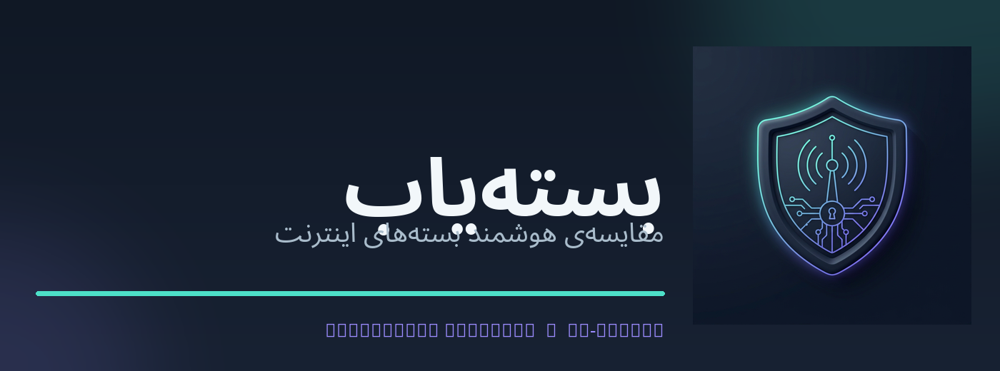

<div dir="rtl">

<p align="center">
  
</p>

<h1 align="center">بسته‌یاب | Bastehyab</h1>

<p align="center">
  ابزار اندرویدی گردآوری، تحلیل و مقایسهٔ بسته‌های اینترنت اپراتورها
</p>

<p align="center">
  
  
  
  
  
</p>

> **وضعیت این بسته:** نسخهٔ 1.9.1 بر پایهٔ قابلیت‌های 1.9.0، pipeline انتشار نسخه‌محور و targetSdk 36 را اضافه می‌کند. مسیر اسکرول و تشخیص پایان فهرست را برای ایرانسل دقیقاً با همان مسیر مشترکِ اعتبارسنجی‌شده با همراه اول اجرا می‌کند؛ هیچ شرط توقف اختصاصی بر اساس شناسهٔ ایرانسل باقی نمانده است. کامل‌بودن درخت Accessibility از پیدا‌شدن بسته جدا شده، fingerprint صفحه متن‌های پایدار و موقعیت آن‌ها را می‌سنجد و پس از چهار چرخهٔ بدون پیشرفت، اسکن به‌صورت محدود و امن متوقف می‌شود؛ نبود شواهد کافی به‌عنوان موفقیت گزارش نمی‌شود. پس‌زمینهٔ متحرک یخ/آتش و چرخهٔ ذرات حذف شده و با شبکهٔ امنیتی کم‌کنتراست و حرکت محدود روی مسیرهای ثابت جایگزین شده است؛ حلقه با توقف Activity، مخفی‌شدن/جداشدن View، فعال‌شدن Reduce Motion یا Battery Saver، یا غیرفعال‌شدن انیمیشن‌های Android متوقف می‌شود. نشان سپر/بسته، آیکون لانچر و پالت فیروزه‌ای/آبی نیز یکپارچه شده‌اند. تمام smoke testهای محلی اجرا می‌شوند؛ ساخت APK و اسکن زندهٔ نسخه‌های واقعی برنامه‌های اپراتور هنوز باید در GitHub Actions و روی دستگاه تأیید شود.

</div>

---

## معرفی

بسته‌یاب یک برنامهٔ اندرویدی برای استخراج پیشنهادهای قابل‌مشاهدهٔ بسته‌های اینترنت از برنامه‌های اپراتورها و مقایسهٔ آن‌هاست. خواندن رابط اپراتور از طریق **Android Accessibility Service** و فقط پس از اقدام و تأیید کاربر انجام می‌شود. داده‌های استخراج‌شده در حافظهٔ محلی پردازش و نگهداری می‌شوند؛ قیمت، حجم، اعتبار، واحد پول و محدودیت‌های هر بسته در موتور مقایسه استفاده می‌شوند.

پروژه با Java و Android SDK ساخته شده و کتابخانهٔ ثالث زمان اجرا در `app/build.gradle` تعریف نشده است. رابط برنامه فارسی و راست‌به‌چپ است.

## امکانات اصلی

- اسکن صفحهٔ بسته‌های اینترنت پس از انتخاب اپراتور و تأیید صریح کاربر.
- استخراج و نرمال‌سازی عنوان، حجم، مدت اعتبار، قیمت و محدودیت بسته‌ها.
- تشخیص واحد پول و تبدیل نمایش تومان/ریال بدون تغییر مقدار پایهٔ ذخیره‌شده.
- مقایسه و رتبه‌بندی بر اساس معیارهایی مانند قیمت هر گیگابایت و مدت اعتبار.
- فیلتر بسته‌های ویژه، شبانه، بین‌الملل و رومینگ با منطق مستقل.
- نگهداری محلی داده‌ها و تاریخچهٔ تغییر قیمت/حجم/اعتبار.
- صف بازبینی برای داده‌های مبهم؛ مقدار خام و اصلاح دستی از هم جدا هستند.
- پنجرهٔ شناور اسکن برای شروع، مکث، ادامه و مشاهدهٔ نتیجهٔ نهایی.
- ذخیره‌سازی مقاوم‌تر با فایل موقت و پشتیبان، و ثبت خطاهای تاریخچه با کدهای فاقد متن صفحه.

## زبان طراحی و رابط کاربری

- تم پیش‌فرض «سایبری نیمه‌شب» از سرمه‌ای عمیق، سطوح آبی‌ـ‌خاکستری و فیروزه‌ای کنترل‌شده برای اقدام اصلی استفاده می‌کند؛ رنگ دوم نیلی است و رنگ‌های وضعیت فقط برای معنای واقعی به‌کار می‌روند.
- زمینهٔ یخ/آتش و ذرات حذف شده‌اند. پس‌زمینهٔ تازه شبکه‌ای امنیتی با مسیرهای مداری، بسته‌های دادهٔ متحرک، پالس آرام گره‌ها و scanline کم‌کنتراست دارد؛ حلقه فقط هنگام نمایش Activity فعال است و با pause/hidden شدن متوقف می‌شود.
- فونت فارسی/عربی Noto Sans Arabic به‌صورت محلی در سه وزن Regular، Medium و Bold بارگذاری می‌شود؛ برای حالت نبود فایل فونت، fallback سیستم تعریف شده است.
- کارت‌ها از سطوح یکپارچه، حاشیهٔ ظریف و برجستگی محدود استفاده می‌کنند؛ کنترل‌های اصلی حداقل ارتفاع لمسی ۴۸dp دارند.
- اسکریپت `tools/ui-layout-smoke-tests/palette-contrast.py` نسبت کنتراست متن و کنترل‌ها را برای تم تاریک، روشن و تک‌رنگ بررسی می‌کند.

## گردش کار اسکن خودکار

1. کاربر در بسته‌یاب اپراتور را انتخاب می‌کند؛ برای ایرانسل شناسهٔ بستهٔ فعلی `com.myirancell` است.
2. سرویس به برنامهٔ اپراتور هدایت می‌شود و پنجرهٔ شناور پس از بازشدن برنامه نمایش داده می‌شود.
3. کاربر باید صفحهٔ بسته‌های اینترنت را باز کند و دکمهٔ «تایید و شروع» را بزند.
4. سرویس ساختار قابل‌دسترسی صفحه را می‌خواند، بسته‌ها را استخراج می‌کند و سپس پیمایش تطبیقی را آغاز می‌کند.
5. همهٔ اپراتورها، از جمله ایرانسل، از یک راهبرد مشترک پیمایش استفاده می‌کنند: ابتدا `ACTION_SCROLL_FORWARD`، سپس در صورت ثابت‌ماندن نمای صفحه حرکت لمسی داخل فهرست و در مرحلهٔ بعد حرکت در ناحیهٔ محتوای برنامه.
6. فهرست اسکرول‌پذیر با معیار عمومی انتخاب می‌شود. fingerprint ترکیبی از مشخصات بسته‌های دیده‌شده و متن‌های پایدارِ قابل‌مشاهده همراه با موقعیت صفحه است؛ ساعت، شمارنده و متن‌های در حال بارگذاری از آن کنار گذاشته می‌شوند. هیچ شاخهٔ اختصاصی مبتنی بر شناسه‌های داخلی UI ایرانسل باقی نمانده است.
7. کامل‌بودن درخت Accessibility مستقل از تعداد بسته‌های استخراج‌شده ثبت می‌شود؛ خالی‌بودن یک صفحه به‌تنهایی به معنی ناقص‌بودن درخت نیست. اگر صفحه واقعاً حرکت نکند، راهبرد اسکرول مرحله‌به‌مرحله عوض می‌شود و پس از چهار چرخهٔ بدون پیشرفت، اسکن متوقف می‌شود.
8. پایان موفق فقط با شواهد مستقل انتهای فهرست تأیید می‌شود. اگر شواهد کافی نباشد، نتیجه «پایان فهرست تأیید نشد» است؛ این توقف امن، پایان موفق یا ۱۰۰٪ جعلی نیست.
9. مسیر پیمایش و تشخیص پایان برای تمام اپراتورها یکسان است؛ parser عمومی متن و داده‌های قابل‌مشاهده را تفسیر می‌کند و تنظیمات/واحد پول فقط در لایهٔ پیکربندی اپراتور باقی می‌ماند.

**نکتهٔ مهم:** پذیرفته‌شدن فرمان اسکرول، به‌تنهایی اثبات نمی‌کند که محتوا حرکت کرده است. تشخیص حرکت و پایان فهرست برای همه اپراتورها از یک منطق مشترک استفاده می‌کند: بررسی تغییر viewport، انتخاب ناحیه‌ی عمودی قابل پیمایش، fallback ژست و شواهد مستقل انتهای فهرست. وجود کنترل «نمایش بیشتر» یا ناقص‌بودن درخت دسترسی مانع تأیید پایان می‌شود؛ هیچ کنترل خرید یا صفحه‌بندی بدون اقدام کاربر لمس نمی‌شود. تفاوت اپراتورها فقط در parser و قواعد نرمال‌سازی داده‌ی بسته‌ها باقی می‌ماند.

## وضعیت پیکربندی اپراتورها

شناسه‌های پیش‌فرض تعریف‌شده در `Cfg.java`:

| اپراتور | شناسهٔ بستهٔ اندروید |
|---|---|
| ایرانسل | `com.myirancell` |
| همراه اول | `ir.mci.ecareapp` |
| رایتل | `ir.rightel.myrightel` |
| سامانتل | `com.mysamantel` |
| شاتل | `com.shmapp` |

وجود شناسه در تنظیمات به معنی تضمین سازگاری با تمام نسخه‌های فعلی برنامهٔ اپراتور نیست. نسخهٔ UI، دستگاه، Android و ساختار Accessibility می‌توانند نتیجهٔ استخراج را تغییر دهند. برای ادعای پشتیبانی قطعی، هر اپراتور به fixture ناشناس‌شده و آزمون زنده نیاز دارد.

## فناوری‌ها و نیازمندی‌های ساخت

| جزء | مقدار |
|---|---|
| زبان | Java 17 |
| Android Gradle Plugin | 8.13.2 |
| Gradle Wrapper | 8.13 (CI bootstrap; commit artifact pending) |
| `compileSdk` | 36 |
| `targetSdk` | 36 |
| `minSdk` | 24 — Android 7.0 |
| R8 / minify | خاموش؛ فعال‌سازی فقط پس از keep rules و آزمون reflection/resource |
| تست JVM | JUnit 4.13.2 |
| تست واقعی Android | AndroidX Test Runner 1.6.2 / Core 1.6.1 |

### ساخت محلی

پیش‌نیازها: JDK 17 و Android SDK Platform 36 به همراه Build Tools 36.0.0. منبع یگانهٔ نسخه `version.properties` است.

```bash
java -version
# After committing the official Wrapper artifact from CI:
./gradlew --version
./gradlew clean :app:lintDebug :app:testDebugUnitTest :app:assembleDebug
```

خروجی Debug در مسیر `app/build/outputs/apk/debug/app-debug.apk` قرار می‌گیرد.

> **وضعیت Gradle Wrapper:** این محیط فاقد Gradle و دسترسی شبکه برای دریافت باینری رسمی بود؛ بنابراین JAR ساختگی اضافه نشده است. CI با Gradle رسمی 8.13، Wrapper را تولید و SHA-256 آن را با checksum منتشرشدهٔ Gradle تطبیق می‌دهد و artifact هفت‌روزهٔ `bastehyab-gradle-wrapper-8.13` را ارائه می‌کند. فایل‌های `gradlew`، `gradlew.bat`، `gradle/wrapper/gradle-wrapper.jar`، `gradle-wrapper.properties` و checksum را از آن artifact دریافت و در مخزن commit کنید تا Wrapper کامل در checkoutهای بعدی موجود باشد.

### نسخه و versionCode

`version.properties` تنها منبع canonical است: `VERSION_NAME` برای app metadata، README badge، diagnostic و release notes؛ `VERSION_CODE` برای APK. برای هر انتشار، هر دو مقدار را بازبینی کنید و `VERSION_CODE` را از مقدار قبلی بزرگ‌تر کنید؛ از تاریخ یا شماره اجرای CI برای تولید آن استفاده نمی‌شود.

پیش از فعال‌کردن Release، در GitHub Repository Variables مقدار `PUBLISHED_VERSION_CODE_BASELINE` را برابر بزرگ‌ترین versionCode منتشرشده در Play Console و تمام فروشگاه‌های خارجی وارد کنید. برای واردکردن APK مرجع خارجی، نسخهٔ اصلی upload-signed (پیش از re-sign شدن توسط فروشگاه؛ در Play App Signing) را در یک Release مرجع با tag دلخواه (مثلاً `play-store-baseline`) بسازید، فایل امضاشده را با نام دقیق `Bastehyab-Published-Baseline.apk` به آن پیوست کنید و متغیر `PUBLISHED_BASELINE_RELEASE_TAG` را برابر همان tag قرار دهید؛ workflow package، versionCode و گواهی امضا را از آن APK بررسی می‌کند و در صورت نبود release قبلی GitHub، از آن برای آزمون نصب/ارتقا استفاده می‌کند. Release اگر versionCode کاندید از این baseline یا از آخرین APK انتشار GitHub بزرگ‌تر نباشد، متوقف می‌شود. اگر امضای مجدد فروشگاه (برای Play App Signing) فعال است، APK دانلودشده از Play ممکن است با کلید app-signing گوگل امضا شده باشد و با upload key تفاوت داشته باشد؛ برای آزمون sideload upgrade، artifact اصلی upload-signed را وارد کنید. آزمون به‌روزرسانی واقعی از مسیر Play internal track همچنان باید جداگانه در Play Console انجام شود.

### انتشار

- Push عادی به branchها فقط CI و Debug artifact را اجرا می‌کند؛ هیچ Release نمی‌سازد.
- انتشار با tag دقیق `v<VERSION_NAME>` یا `workflow_dispatch` از branch `main` انجام می‌شود.
- برای job محیط `release` در GitHub Settings یک Environment با همین نام بسازید و Required reviewers را فعال کنید؛ این approval بیرون از YAML تنظیم می‌شود.
- چهار Secret لازم فقط در job انتشار در دسترس‌اند: `ANDROID_KEYSTORE_BASE64`، `KEYSTORE_PASSWORD`، `KEY_ALIAS` و `KEY_PASSWORD`.
- Release notes مستقیماً از بخش همان نسخه در `CHANGELOG.md` استخراج می‌شوند. انتشار تکراری/جایگزینی tag یا asset موجود عمداً رد می‌شود؛ برای enforcement سمت GitHub نیز گزینهٔ Immutable releases را در تنظیمات مخزن فعال کنید.

### ملاحظات targetSdk 35/36

- Android 15 / target 35 اجباری‌شدن edge-to-edge را به همراه دارد؛ محتوا باید Window Insets بالایی/پایینی را رعایت کند و به رنگ‌دهی قدیمی system bar متکی نباشد.
- Android 16 / target 36 opt-out از edge-to-edge را غیرفعال می‌کند؛ predictive back فعال است و `onBackPressed`/`KEYCODE_BACK` مسیر قابل اتکایی برای interception نیستند.
- روی نمایشگرهای `sw600dp` محدودیت‌های orientation، aspect ratio و resizability نادیده گرفته می‌شوند؛ UI باید در حالت landscape، multi-window و پنجره‌های قابل تغییر اندازه بررسی شود.
- `ScanService` از foreground service نوع dataSync استفاده نمی‌کند؛ اگر در آینده افزوده شد، محدودیت timeout شش‌ساعتهٔ Android 15 و محدودیت شروع از `BOOT_COMPLETED` باید رعایت شود.
- کد فعلی رنگ system bar را مستقیماً تنظیم می‌کند و مسیر عمومی WindowInsets در Activity دیده نشد؛ بنابراین ارتقای targetSdk به 36 نیازمند آزمون بصری واقعی روی API 35/36 است و صرف موفقیت build، سازگاری edge-to-edge را اثبات نمی‌کند.

## اجرای آزمون‌ها

از ریشهٔ پروژه:

```bash
bash tools/fixture-sanitizer/test.sh
bash tools/parser-smoke-tests/run.sh
bash tools/android-core-smoke-tests/run.sh
bash tools/popup-overlay-smoke-tests/run.sh
bash tools/ui-layout-smoke-tests/run.sh
bash tools/backdrop-instrumentation-tests/run.sh
bash tools/android-core-smoke-tests/check-accessibility-api.sh
bash tools/privacy-consent-tests/test.sh
```

تست‌های Parser/Store/Popup از test doubleهای محدود برای منطق مستقل استفاده می‌کنند. بررسی پس‌زمینه دیگر با Stubهای دست‌ساز انجام نمی‌شود: `AppBackdropInstrumentationTest` با AndroidX Test روی View، ValueAnimator، تنظیمات واقعی سیستم، چرخهٔ Activity و FPS/CPU دستگاه یا Emulator اجرا می‌شود. بررسی Static Review فقط guardrail منبع است و **جایگزین آزمون Instrumentation واقعی نیست**.

برای آزمون بازپخش dump ناشناس‌شده:

```bash
bash tools/dump-replay/run.sh <dump_dir> <package> <currency>
```

## حریم خصوصی، رضایت و استفاده از Accessibility

- **بدون استخراج منفعل:** رویدادهای Accessibility به‌تنهایی هیچ اسکن یا خواندن درخت صفحه‌ای را آغاز نمی‌کنند. مسیر اسکن پس‌زمینه/منفعل حذف شده است.
- **رضایت چندمرحله‌ای:** پیش از تنظیمات Android، برنامه یک disclosure مستقل و برجسته نمایش می‌دهد. کاربر باید دکمهٔ «می‌پذیرم؛ بازکردن تنظیمات اندروید» را بزند. فعال‌کردن سرویس نیز به‌تنهایی اسکن را آغاز نمی‌کند. برای هر نشست، پس از انتخاب اپراتور و بازکردن صفحهٔ بسته‌ها، اقدام جداگانهٔ «تأیید و شروع» لازم است. رد یا لغو، سایر بخش‌های برنامه را محدود نمی‌کند.
- **دامنهٔ خواندن:** فقط ساختار و متن قابل‌دسترسی پنجرهٔ فعالِ package انتخاب‌شده برای یافتن کارت‌های بسته بررسی می‌شود؛ مانند عنوان/شناسهٔ عمومی، قیمت، حجم و مدت. برچسب‌های دیگرِ قابل‌مشاهده در همان صفحه ممکن است موقتاً در حافظهٔ پردازش دیده شوند؛ گره‌های قابل‌ویرایش و رمزدار خوانده نمی‌شوند و فقط فیلدهای ساختاریافتهٔ بسته نگهداری می‌شوند. برنامه‌های بانکی، پیام‌رسان‌ها و packageهای نامرتبط پردازش نمی‌شوند.
- **قابلیت مشاهدهٔ بسته‌ها در Android:** `<queries>` در Manifest فقط Intent عمومی `MAIN/LAUNCHER` را برای پشتیبانی از اپراتورهای سفارشی قابل‌انتخاب درخواست می‌کند؛ این مورد به‌تنهایی مجوز خواندن صفحه نیست. رویدادهای Accessibility در حالت idle به پنج اپراتور داخلی محدودند و هنگام نشست دقیقاً به package انتخابی محدود می‌شوند.
- **اپراتورهای مجاز:** allowlist اولیه شامل `com.myirancell`، `ir.mci.ecareapp`، `ir.rightel.myrightel`، `com.mysamantel` و `com.shmapp` است. اپراتور سفارشی فقط وقتی قابل اسکن است که کاربر آن را در تنظیمات اپراتورها تعریف کرده، همان اپراتور را انتخاب کند و تأیید مخصوص همان نشست را انجام دهد؛ در زمان نشست، allowlist رویدادها دقیقاً به همان package انتخابی محدود می‌شود و فقط درخت پنجرهٔ فعال همان برنامه خوانده می‌شود. اگر تنظیم فیلتر runtime ناموفق باشد، نشست اصلاً شروع نمی‌شود. خطای اعتبارسنجی یا نبود اپراتور فعال به معنی عدم اسکن است.
- **دادهٔ ذخیره‌شده:** عنوان/شناسهٔ عمومی بسته، قیمت، حجم، مدت، دسته‌بندی/علت محدودیت، وضعیت و یادداشت بازبینی، تاریخچهٔ تغییرات و شمارنده‌های محدود اسکن در فایل‌های محلی برنامه ذخیره می‌شود. متن خام صفحه، رمزها، فیلدهای ورودی، اطلاعات حساب، پیام‌ها و اطلاعات پرداخت ذخیره نمی‌شود. اطلاعات ساختاریافته از بخش پاک‌کردن اطلاعات قابل حذف است.
- **ارسال شبکه‌ای:** سورس فعلی مجوز `INTERNET` اعلام نمی‌کند و هیچ مسیر ارسال صفحه/بسته به سرور بسته‌یاب ندارد. خود برنامهٔ اپراتور ممکن است برای بارگیری صفحهٔ خود از اینترنت استفاده کند.
- **پیمایش خودکار:** پس از تأیید نشست، سرویس ممکن است فرمان `ACTION_SCROLL_FORWARD` یا swipe عمودی در محدودهٔ فهرست/صفحه انجام دهد تا بسته‌های پایین‌تر دیده شوند. هیچ دکمهٔ خرید، پرداخت یا فعال‌سازی لمس نمی‌شود.
- **لغو فوری:** دکمهٔ خروج/توقف نشست را می‌بندد. با غیرفعال‌کردن سرویس Accessibility، callbackها، taskهای زمان‌بندی‌شده و worker متوقف می‌شوند و gesture جدیدی ارسال نمی‌شود.
- **توضیح سرویس:** توضیح داخل Android Settings همین دامنهٔ داده، پردازش محلی و امکان swipe را بیان می‌کند. `isAccessibilityTool=true` عمداً اعلام نشده است.
- **محدودیت ادعای سیاست:** این مستندات تضمین پذیرش Google Play یا هر فروشگاه دیگری نیستند؛ مالک انتشار باید فرم‌ها و ویدئوی نمایشی را تکمیل و سیاست روز انتشار را بررسی کند.

### ناشناس‌سازی dump

ابزار زیر نسخهٔ خروجی می‌سازد و فایل ورودی را تغییر نمی‌دهد:

```bash
python3 tools/fixture-sanitizer/sanitize_accessibility.py \
  /path/to/accessibility_tree.txt \
  /path/to/accessibility_tree.sanitized.txt
```

ماسک‌سازی خودکار تضمین ناشناس‌بودن نیست؛ خروجی را پیش از اشتراک‌گذاری دستی بررسی کنید.

## ساختار سورس

```text
app/src/main/java/app/bastehyab/
  Cfg.java                 تنظیمات، شناسه‌ها و snapshot اپراتورها
  Op.java                  مدل اپراتور
  OpSnapshot.java          snapshot تغییرناپذیر نشست
  Pkg.java                 مدل بسته و اطلاعات بازبینی دستی
  Extractor.java           parser و نرمال‌سازی داده‌های صفحه
  Compare.java             محاسبه و رتبه‌بندی پیشنهادها
  ScanService.java         Accessibility، زمان‌بندی اسکن و پیمایش
  ListEndDetector.java     تشخیص سه‌حالتهٔ پایان فهرست با شواهد scroll و viewport
  Popup.java               پنجرهٔ مقایسه و کنترل اسکن
  Store.java               ذخیره‌سازی محلی و بازیابی پشتیبان
  History.java             مقایسهٔ دو مشاهده
  HistoryLog.java          تاریخچه و کدهای خطا
  MainActivity.java        رابط اصلی و صف بازبینی
  SplashViews.java         اجزای splash
  UI.java                  اجزای عمومی رابط

app/src/test/               تست‌های JVM
tools/                      ابزارهای توسعه و smoke test
.github/workflows/           CI و Release
branding/                    لوگو و دارایی‌های بصری
```

## CI و انتشار

Workflow اصلی در `.github/workflows/android-build.yml` قرار دارد:

- job ساخت/تست با مجوز `contents: read` اجرا می‌شود.
- smoke testها، Android Lint، JUnit، ساخت Debug و تست Instrumentation روی Android Emulator API 36 در CI تعریف شده‌اند.
- job انتشار فقط برای tag هم‌نام با `VERSION_NAME` یا اجرای دستی از `main` و پس از approval محیط محافظت‌شدهٔ `release` اجرا می‌شود؛ push عادی به `main` انتشار نمی‌سازد.
- actionهای GitHub با SHA کامل pin شده‌اند.
- کلید امضا از GitHub Secrets خوانده می‌شود و نباید داخل مخزن قرار گیرد.

Secrets موردنیاز انتشار در مستندات `GITHUB_ACTIONS_BUILD_FA.md` و `BAZAAR_SIGNING_FA.md` شرح داده شده‌اند.

## مستندات پروژه

| سند | توضیح |
|---|---|
| [گزارش ممیزی و نقشهٔ راه 1.6.8](AUDIT_AND_ROADMAP_1_6_8_FA.md) | یافته‌های سورس و لاگ، اصلاح اعمال‌شده، ریسک‌ها و اولویت‌ها |
| [پرامپت‌های آمادهٔ توسعه](PROMPTS_NEXT_STEPS_FA.md) | وظایف بعدی به‌شکل پرامپت قابل‌کپی |
| [گزارش اسکن و هویت بصری 1.8.0](SCAN_AND_CYBER_REDESIGN_1_8_0_FA.md) | توقف دقیق‌تر فهرست، لوگوی جدید و پس‌زمینهٔ سایبری لوپ‌دار |
| [گزارش اسکرول ایرانسل 1.6.7](IRANCELL_AUTOSCROLL_FIX_1_6_7_FA.md) | سابقهٔ فرمان پذیرفته‌شده اما بی‌اثر و fallback gesture |
| [گزارش بازیابی پنجره 1.6.8](POPUP_RECOVERY_FIX_1_6_8_FA.md) | watchdog و بازیابی پنجرهٔ شناور |
| [وضعیت ممیزی قبلی](AUDIT_IMPLEMENTATION_STATUS_1_6_5_FA.md) | تاریخچهٔ انجام/باقی‌ماندن پیشنهادهای ممیزی قبلی |
| [تغییرات نسخه‌ها](CHANGELOG.md) | تاریخچهٔ تغییرات |
| [برنامهٔ معماری](ARCHITECTURE_PLAN_FA.md) | تفکیک پیشنهادی adapter، شواهد و دامنه‌ها |

## وضعیت فعلی و محدودیت‌های باز

| موضوع | وضعیت |
|---|---|
| انتخاب ناحیهٔ اسکرول | انتخاب عمومی و مشترک برای پنج اپراتور + تست رگرسیون محلی |
| fingerprint صفحه و شواهد پایان | مستقل از شناسهٔ اپراتور؛ توقف محدود پس از چهار چرخهٔ بدون حرکت |
| پس‌زمینه و پالت رابط | شبکهٔ کم‌حرکت با سقف invalidation حدود ۳۰fps؛ Auto/System، Dark، Light، Mono؛ Battery Saver و Reduce Motion حلقه را خاموش می‌کنند؛ کنتراست سه تم آزمون شده |
| پیام وضعیت پنجرهٔ شناور | چندخطی + گزارش نهایی پس از توقف خودکار |
| تشخیص پایان فهرست | به چرخهٔ `ScanService` متصل؛ event range/item index و fallback fingerprint با guardهای محافظه‌کارانه؛ نیازمند آزمون دستگاهی هر اپراتور |
| سازگاری با نسخه‌های مختلف MyIrancell | نیازمند آزمون روی گوشی و fixture نسخه‌دار |
| ساخت APK، Android Lint و تست Instrumentation | در محیط تدوین این بسته اجرا نشده؛ Workflow CI برای API 36 و `connectedDebugAndroidTest` تنظیم شده است |
| Gradle Wrapper | کامل نیست |
| تست instrumentation / emulator | AndroidX Test اضافه شده؛ چرخهٔ عمر View، Reduce Motion، Battery Saver، animator scale، Auto/night mode و اندازه‌گیری FPS/CPU در Emulator API 36 در CI اجرا می‌شوند |
| confidence و evidence برای هر فیلد parser | در نقشهٔ راه باقی مانده است |

برای جزئیات و پرامپت‌های پیاده‌سازی، [گزارش ممیزی](AUDIT_AND_ROADMAP_1_6_8_FA.md) و [پرامپت‌های توسعه](PROMPTS_NEXT_STEPS_FA.md) را ببینید.

## مجوز و حقوق توزیع

در سورس فعلی فایل `LICENSE` یا `NOTICE` ارائه نشده است؛ بنابراین مجوز استفاده، تغییر یا بازتوزیع پروژه از داخل مخزن قابل استنتاج نیست. پیش از انتشار عمومی یا تجاری، مالک پروژه باید مجوز مناسب و حقوق دارایی‌های بصری/برند را مشخص کند.

## مشارکت در توسعه

پیشنهاد می‌شود هر تغییر رفتاری با یک تست رگرسیون همراه باشد. برای تغییر parser یا adapter اپراتور، fixture باید ناشناس‌شده و نسخهٔ برنامهٔ اپراتور مشخص باشد. تغییرات مربوط به Accessibility باید علاوه بر تست JVM با آزمون واقعی روی Android و بررسی touch/scroll، lifecycle و window layering تأیید شوند.

</div>
